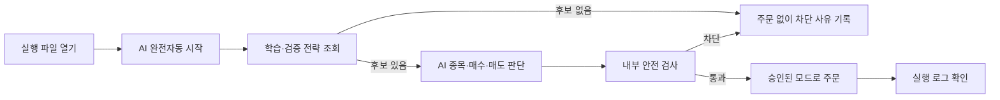
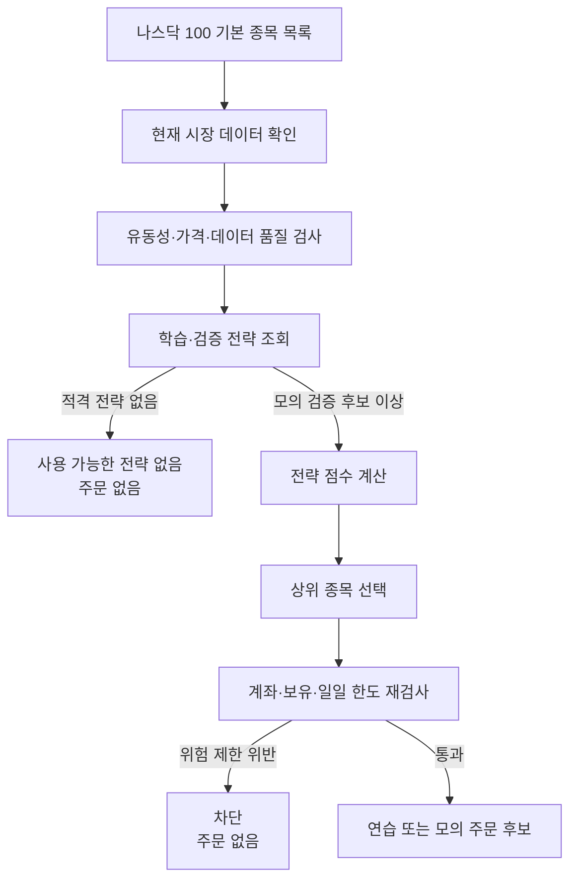
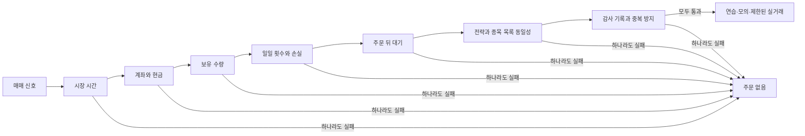

<!-- markdownlint-disable MD013 MD033 -->

# Nasdaq Auto Trader

## 2026-09-08 실행 경로 정리

이번 변경의 범위와 검증 결과는 [실행 경로 리팩터링 보고서](docs/LIVE-RUNTIME-REFACTOR-2026-09-08.md)를 기준으로 확인하세요. 아래 날짜가 적힌 배포 판정은 당시 기록이며 현재 계좌의 LIVE 승인 상태를 뜻하지 않습니다. 저장된 사용자 설정은 기본값과 다를 수 있습니다.

- 전략이 `no_trade`로 판단하면 강제 매수하지 않습니다. 과거의 `daily_forced_order_enabled` 설정은 최소 매수를 발생시키지 않습니다.
- 고정 주수도 종목 비중·현금 여유분·주문금액·거래당 위험 상한을 적용합니다.
- TradingAgents의 매수/매도 문구에 신뢰도를 임의로 붙이지 않습니다. 해당 출력은 참고 분석입니다.
- ‘자가학습’은 후보 생성·과거자료 검증입니다. 수익성이나 자동 실거래 자격을 얻는 모델 학습이 아닙니다.
- 단일 백테스트만으로 만든 가짜 교차검증·과적합 확률을 제거합니다. 독립 검증 증거가 없으면 새 후보의 승격을 차단하며, 기존 개인 전략 기록을 임의 삭제하지 않습니다.
- GS Quant의 로컬 통계 정의를 참고하되 기관 인증 API나 전체 SDK를 실행에 추가하지 않습니다.

실행 파일이 정상 동작하는 것과 실계좌 주문 조건을 충족하는 것은 별개입니다. 실제 주문 시험, 자금 한도 변경, 보유분 처분은 이 리팩터링의 검증에 포함하지 않습니다.

## 제한형 무인 실거래 카나리

검증된 CHAMPION 전략이 없어도 별도 `live-canary` 역할로 미국 정규장 동안 소액 실거래 E2E를 시험할 수 있습니다. 수익을 보장하지 않으며 기존 GUI·CHAMPION 안전장치를 완화하지 않습니다.

| 통제 항목 | 변경할 수 없는 한도 |
| --- | ---: |
| 매수 지정가 / 총 현금 게이트 | USD 19.50 / USD 20.00 |
| 주문 수량 / 동시 보유 | 1주 / 1종목 |
| 일일 진입 시도 / 왕복 거래 | 최대 3회 / 최대 3회 |
| 익절 / 손절 | 평균 진입가 대비 +5% / -5% |
| 진입 구간 / 강제 청산 시작 | 개장 +15분~마감 -30분 / 마감 -15분 |
| 재진입 대기 | 청산 확인 후 30분 |
| 가격 / 보유수량 / 후보 스캔 | 15초 / 60초 / 15분 |

사전점검은 주문·취소 API를 호출하지 않습니다. 유효한 OAuth 토큰이 없으면 인증 토큰 발급용 POST가 발생할 수 있지만 거래 주문은 제출하지 않으며 `submitted_order=false`를 반환합니다.

```powershell
cd C:\Users\u\Desktop\nasdaq-auto-trader
python -m nasdaq_auto_trader --config config.kis.json live-canary-preflight
```

`ready=true`, `cash_gate_met=true`, `position_count=0`, `open_order_count=0`을 모두 확인한 뒤 해당 뉴욕 시장일에 한 번만 승인합니다. `mode=live`, `broker=kis`, `allow_live_trading=true`, `kis.paper=false`, 환경변수 `NASDAQ_AUTO_TRADER_ALLOW_LIVE=YES`가 필요합니다.

```powershell
python -m nasdaq_auto_trader --config config.kis.json live-canary-arm `
  --market-date <뉴욕시장일-YYYY-MM-DD> `
  --confirm "I UNDERSTAND THIS WILL PLACE REAL ORDERS TODAY"
python -m nasdaq_auto_trader --config config.kis.json live-canary
```

승인은 시장일·계좌·정책·Windows SID·실행 코드 SHA-256에 묶입니다. 소스 실행은 패키지의 모든 Python 소스를, EXE 실행은 EXE 파일을 해시합니다. 정확한 KIS 주문번호가 없는 POST 응답은 영구 수동조정 상태가 되며 주문을 추정하거나 재제출하지 않습니다.

빌드된 EXE 감시 작업은 다음 명령으로 설치합니다. 감시 작업은 승인 파일을 만들거나 갱신하지 않습니다.

```powershell
powershell -ExecutionPolicy Bypass -File .\scripts\install_live_canary_task.ps1
```

감사 로그는 `%LOCALAPPDATA%\NasdaqAutoTrader\live_canary\audit`에 저장됩니다. 승인 만료 후 신규 매수는 차단되며, 확인된 1주가 남은 경우에만 다음 정규장에서 매도 전용 `EXIT_ONLY` 복구가 가능합니다.

## 2026-07-17 소액 무인 실거래 카나리

검증된 CHAMPION 전략이 없어도, 별도의 `live-canary` 역할로 오늘 미국 정규장 동안만 소액 실거래 E2E를 시험할 수 있습니다. 이 경로는 기존 GUI 자동매매의 승인 기준을 낮추지 않습니다.

고정 한도는 설정이나 CLI로 완화할 수 없습니다.

| 항목 | 고정값 |
| --- | ---: |
| 매수 지정가 상한 | USD 19.50 |
| 수수료 예비금 포함 현금 게이트 | USD 20.00 |
| 주문 수량 / 동시 보유 | 1주 / 1종목 |
| 일일 진입 시도 / 왕복 거래 | 최대 3회 / 최대 3회 |
| 익절 / 손절 | 진입 평균가 대비 +5% / -5% |
| 진입 시간 | 개장 15분 후부터 마감 30분 전까지 |
| 강제 청산 시작 | 마감 15분 전 |
| 재진입 대기 | 청산 확인 후 30분 |
| 가격 / 보유수량 / 후보 스캔 | 15초 / 60초 / 15분 |

사전점검의 거래 API는 잔고, 보유종목, 미체결 주문만 GET으로 조회합니다. OAuth 토큰이 없거나 만료되면 토큰 획득 요청은 POST일 수 있지만, 주문은 제출하지 않으며 결과에는 `submitted_order=false`를 유지합니다.

```powershell
cd C:\Users\u\Desktop\nasdaq-auto-trader
python -m nasdaq_auto_trader --config config.kis.json live-canary-preflight
```

`ready: true`, `position_count: 0`, `open_order_count: 0`, `cash_gate_met: true`를 모두 확인한 다음에만 당일 승인을 발급합니다. 설정은 `mode=live`, `broker=kis`, `allow_live_trading=true`, `kis.paper=false`여야 하고 `.env`에는 `NASDAQ_AUTO_TRADER_ALLOW_LIVE=YES`가 필요합니다.

```powershell
python -m nasdaq_auto_trader --config config.kis.json live-canary-arm `
  --market-date 2026-07-17 `
  --confirm "I UNDERSTAND THIS WILL PLACE REAL ORDERS TODAY"
```

승인은 시장일, 실계좌 지문, 실행 파일 SHA-256, 고정 정책 SHA-256, Windows SID와 만료시각에 결합됩니다. 같은 시장일의 승인 또는 상태 파일이 이미 있으면 재발급하여 거래 횟수를 초기화할 수 없습니다.

직접 실행할 때는 다음 명령을 사용합니다.

```powershell
python -m nasdaq_auto_trader --config config.kis.json live-canary
```

빌드된 EXE를 무인 감시하려면 관리자 권한이 아닌 현재 사용자 PowerShell에서 다음 작업을 한 번 설치합니다.

```powershell
powershell -ExecutionPolicy Bypass -File .\scripts\install_live_canary_task.ps1
```

감시 작업은 승인 파일을 만들거나 갱신하지 않습니다. 프로세스가 종료되면 같은 `live-canary` 역할만 다시 시작합니다. 실행 중에는 계좌 단위 broker lease가 GUI, 기존 자동매매, `day-test`, `sell-monitor` 등 다른 KIS 주문 경로의 POST를 차단합니다.

POST 응답에서 정확한 KIS 주문번호를 받지 못하면 유사 주문을 추측하지 않고 영구 `manual_reconciliation_required`로 전환합니다. 이 상태에서는 신규 주문, 자동 취소, 추정 보유분 자동매도를 하지 않습니다. 확인된 1주가 장 마감 뒤 남으면 매수 권한 없이 `EXIT_ONLY` 상태만 다음 정규장으로 복구됩니다.

감사 로그는 `%LOCALAPPDATA%\NasdaqAutoTrader\live_canary\audit`에 시장일별 JSONL로 저장되며 파일당 10 MiB, 30일 보존 한도가 적용됩니다. 계좌번호, 앱 키, 토큰과 원시 브로커 응답은 기록하지 않습니다.

중단할 때는 예약 작업을 사용 안 함으로 바꾸고 `live-canary` 프로세스를 종료합니다. 보유수량이 남아 있으면 `exit-only-state.json`을 삭제하지 말고 청산 복구가 끝날 때까지 유지해야 합니다.

# 나스닥 자동매매 도우미

> 학습·검증된 전략으로 나스닥 종목을 고르고, 여러 안전 장치를 거쳐 매매 후보를 만드는 윈도우용 프로그램

기본 설정: **연습 모드** · 실제 모드는 저장된 개인 설정에 따라 다름 · 최신 검증: [변경 보고서](docs/LIVE-RUNTIME-REFACTOR-2026-09-08.md)

> **주의**
> 이 프로그램은 수익을 보장하지 않습니다. 처음에는 반드시 `실제 돈으로 거래`를 끄고 `연습 모드`를 켜세요.
> 연습 모드는 실제 주문을 보내지 않고 “주문했다면 어땠을지”만 계산하고 기록합니다.

## 2026-07-17 최종 운영 판정

코드, 설치 EXE, 예약 작업, 463개 자동 시험, 설치본 CLI E2E, 금융 안전 및 Git 배포 검토는 통과했습니다. 자세한 증거와 잔여 제한은 [프로덕션 준비도 보고서](docs/PRODUCTION-READINESS-2026-07-17.md)에 기록되어 있습니다.

| 항목 | 당시 상태(2026-07-17) | 설명 |
| --- | --- | --- |
| 설치 프로그램 | 정상 실행 | 설치 경로에서 응답하는 프로세스 1개와 예약 작업 결과 0을 확인했습니다. |
| 무인 운영 | 켜짐 | 로그인 상태에서는 장전 점검, 장중 드라이런 판단, 장후 대사·학습과 오전 보고를 수행합니다. |
| 드라이런 | 켜짐 | 설치본 조회와 당일 시험에서 제출된 실제 주문은 0건이었습니다. |
| LIVE | **승인 안 됨** | 수동 승인·승격된 `CHAMPION` 전략이 없고 환경 승인과 런타임 LIVE도 꺼져 있습니다. |
| 매수 제한 | 현금 이내 | 예수 현금과 증권사 주문 가능액을 모두 확인하며 한도를 넘으면 주문 전에 차단합니다. |
| 매도 제한 | 보유분 이내 | 매도 수량은 실제 보유 수량과 설정 주문 수량 중 작은 값으로 제한되어 공매도를 만들지 않습니다. |
| 오늘 승인된 카나리 EXE | 빌드·설치 일치 | SHA-256 `B81F0CE06B4DAC8A6C614515780A1AE34F64AC479EABE38984D40FD5ADCAF35C` |

위 표는 당시 상태입니다. 현재 개인 설정이나 승인 상태를 뜻하지 않습니다. GUI의 실거래 스위치 하나만 켜거나 `.env`만 바꿔도 주문할 수 없으며, 독립된 모든 LIVE 게이트가 함께 충족되어야 합니다.

## 정말 처음이라면 이것만 따라 하세요

어려운 단어를 몰라도 됩니다. 아래 순서대로 버튼을 **한 번씩만** 누르세요.

### 먼저 알아둘 것

- `학습`은 과거 가격을 살펴보고 사용할 전략을 검사하는 일입니다.
- 학습한다고 실제 주식을 사거나 팔지 않습니다.
- 학습에는 증권사에서 받은 **실제 과거 시세**가 필요합니다.
- 같은 자료로 계속 학습해도 좋아지지 않습니다. **미국 장이 끝난 뒤 하루에 한 번이면 충분합니다.**
- 한국 시간으로 오전 7시 이후에 실행하면 서머타임과 관계없이 미국 정규장이 끝난 뒤입니다.
- 지금은 `LIVE`나 `실제 돈으로 거래`를 사용하지 마세요.

### 처음 실행할 때 확인할 것

1. `NasdaqAutoTrader.exe`를 두 번 눌러 실행합니다.
2. 화면에 `AI 완전자동 운영 모드`가 표시되는지 확인합니다.
3. 프로그램은 별도 설정이나 확인 창 없이 AI 종목 선택과 무인 운영을 즉시 시작합니다.
4. 오른쪽 실행 로그에서 선택 결과나 안전 차단 사유를 확인합니다.

운영 화면에는 설정 버튼, 수동 종목 입력, 자동매매 간격 입력이 없습니다. 종목, 매수·매도 방향, 수량은 학습·검증 전략과 내부 위험 한도가 결정합니다.

### 학습시키는 방법

1. 미국 장이 끝난 한국 시간 오전 7시 이후에 프로그램을 엽니다.
2. 메인 화면에서 `학습만 실행`을 **한 번만** 누릅니다.
3. 학습 중에는 `학습만 실행` 버튼이 잠깁니다. 다른 버튼을 여러 번 누르지 말고 기다립니다.
4. 멈추고 싶을 때만 `학습 취소`를 누릅니다. 취소해도 기존 전략은 지워지지 않습니다.
5. 오른쪽 `실행 로그`의 마지막 부분을 읽습니다.

현재 버전은 연구 실행 완료와 후보 검증 통과를 구분합니다. 정상적으로 연구 보고서를 저장해도 다음처럼 통과 후보가 0개일 수 있습니다.

```text
학습 완료: 상태: 완료
생성 후보: 1개
검증 통과 후보: 0개
제출된 실제 주문: 0건
```

단일 백테스트만 수행한 새 후보는 독립 검증이 없으므로 `REJECTED`로 기록하고 연구 보고서를 보존합니다. 현재 내장 경로에는 독립 검증을 수행하는 구현이 없으므로, 자료를 더 모으거나 버튼을 다시 누르는 것만으로 승격되지 않습니다. 기존에 승인된 전략 기록은 보존합니다.

### 학습 결과에 따라 무엇을 해야 하나요?

| 로그에서 본 내용 | 뜻 | 지금 할 일 |
| --- | --- | --- |
| `independent_validation_required` | 독립 검증이 없는 연구 후보입니다. | 보고서를 확인합니다. 등록소 수정이나 반복 실행으로 승격시키지 않습니다. |
| `data_unchanged` 또는 `새로운 데이터 없음` | 이미 같은 자료로 학습했습니다. | 정상입니다. 그날은 다시 학습하지 않습니다. |
| `검증 통과 후보: 0개` | 이번 실행에서 새 적격 후보를 만들지 못했습니다. | 거절 사유를 확인합니다. 기존 적격 전략 유무와 별개입니다. |
| `market_data_missing` 또는 `검증할 시장 데이터가 없음` | 실제 과거 시세를 가져오지 못했습니다. | [증권사 연결](#증권사-연결)의 키와 설정을 확인합니다. |
| `not_enough_bars` 또는 `검증 기간이 부족함` | 과거 가격 개수가 부족합니다. | 조회 기간과 시세 연결을 확인한 뒤 다음 날 다시 시도합니다. |
| `turnover_too_high`, `최대 낙폭`, `과적합` | 후보가 위험 기준에서 탈락했습니다. | 기록을 직접 고치지 말고 다음 거래일 데이터를 기다립니다. |
| `learning_already_running` | 이미 학습 중입니다. | 첫 번째 학습이 끝날 때까지 기다립니다. |

실패했다고 버튼을 계속 누르지 마세요. 데이터가 바뀌지 않았다면 결과도 좋아지지 않습니다.

### 기존 적격 전략이 있을 때 연습하는 방법

1. 화면 위쪽이 `실주문 차단`과 `드라이런`인지 다시 확인합니다.
2. 오른쪽 로그에서 `AI 자동 선택` 결과를 확인합니다.
3. `selected`이면 연습 대상으로 종목을 골랐다는 뜻입니다.
4. `no_trade`이면 매매 조건이 없다는 뜻입니다. 오류가 아니므로 기다립니다.
5. 잠시 멈추려면 `정지`, 다시 시작하려면 `재개`를 누릅니다.

드라이런에서는 주문 후보가 생겨도 실제 증권사 주문을 보내지 않습니다. 로그의 `제출된 실제 주문`은 항상 `0건`이어야 합니다.

### 매일 해야 하는 일

```text
미국 장 마감 후 오전 7시 이후
        ↓
프로그램 실행
        ↓
학습만 실행 1회
        ↓
연구 보고서·거절 사유 확인
        ↓
드라이런 확인
        ↓
AI 자동 선택·매매 판단 확인
        ↓
필요할 때만 정지
```

처음에는 최소 20거래일 동안 드라이런 또는 PAPER 결과만 관찰하세요. 수익이 났다는 이유만으로 LIVE를 켜면 안 됩니다.

## 현재 배포 판정

| 범위 | 판정 | 실제 주문 | 설명 |
| --- | --- | ---: | --- |
| 드라이런 | 운영 준비 완료 | 없음 | 설치, 설정, 학습, 종목 선택, 위험 차단, 재시작 복구를 확인하는 기본 모드입니다. |
| PAPER | 운영 후보 | 모의계좌만 | 실제 증권사 PAPER 계정으로 충분한 기간 관찰한 뒤 사용해야 합니다. |
| 데스크톱 LIVE | 현재 계정 차단 | 없음 | 코드 경로는 준비됐지만 현재는 승인된 `CHAMPION` 전략, 환경 승인, 런타임 LIVE가 모두 충족되지 않아 주문 전에 차단됩니다. |
| AI 퀀트 `live-cycle` | 차단 | 없음 | 공통 주문 멱등 게이트가 통합되지 않아 `shared_order_gateway_required`로 중단합니다. |
| 명령줄 제한 LIVE | 검증 전 | 가능 | 운영자가 모든 잠금을 직접 켜는 고급 경로이며 현재 배포의 프로덕션 준비 범위가 아닙니다. |

따라서 이 문서에서 “운영 준비”는 **드라이런과 PAPER 안전 운용까지**를 뜻합니다. 데스크톱 LIVE 경로는 열려 있지만 실제 계좌 주문 E2E를 자동 검증하지 않으므로 운영 완료 판정을 뜻하지 않습니다.


## 30초 요약

| 궁금한 점 | 답 |
| --- | --- |
| 무엇을 하나요? | 가격과 거래량, 기술 지표, 학습·검증된 전략을 이용해 매매 후보를 찾고 위험 한도를 검사합니다. |
| 종목을 직접 골라야 하나요? | 아닙니다. 적격 학습 전략이 있으면 나스닥 100 종목 안에서 자동으로 고를 수 있습니다. |
| 설치 직후 바로 자동 선택되나요? | 아닙니다. 사용할 수 있는 모의 검증 후보 또는 대표 전략이 없으면 주문 없이 멈춥니다. |
| 실행 파일을 열면 실제 주문이 나가나요? | AI 자동운영은 즉시 시작되지만 기본값은 연습 모드입니다. LIVE 주문은 별도의 환경 승인과 모든 내부 안전 검사를 통과해야만 가능합니다. |
| 처음에 무엇을 해야 하나요? | 실행 → `AI 완전자동 운영 모드` 확인 → 실행 로그 확인 순서로 진행합니다. 필요할 때만 `학습만 실행`을 누릅니다. |
| 문제가 생기면 어디를 보나요? | 오른쪽 `실행 로그`와 [자주 발생하는 오류](#자주-발생하는-오류)를 확인합니다. |

## 바로 찾기

- [처음 사용하는 사람을 위한 5분 시작](#처음-사용하는-사람을-위한-5분-시작)
- [정말 처음이라면 이것만 따라 하세요](#정말-처음이라면-이것만-따라-하세요)
- [메인 화면 읽는 법](#메인-화면-읽는-법)
- [자동 종목 선택 원리](#자동-종목-선택은-어떻게-작동하나요)
- [내부 안전 장치](#내부-안전-장치)
- [자주 발생하는 오류](#자주-발생하는-오류)
- [증권사 연결](#증권사-연결)
- [명령줄 사용법](#명령줄-사용법)
- [실행 파일 빌드와 배포](#실행-파일-빌드와-배포)
- [안전 장치와 한계](#안전-장치와-한계)

## 처음 사용하는 사람을 위한 5분 시작

### 1. 폴더 전체를 확인합니다

`NasdaqAutoTrader.exe` 하나만 떼어내면 실행되지 않습니다. 아래 폴더를 통째로 사용하세요.

```text
dist\
└─ NasdaqAutoTrader\
   ├─ NasdaqAutoTrader.exe
   ├─ config.example.json
   ├─ config.kis.json
   ├─ .env.example
   └─ _internal\
```

`config.kis.json`은 빌드할 때 원본 파일이 있을 때만 포함됩니다. 런타임 안전 상태 파일은 실행 파일 폴더에 복사하지 않습니다. `_internal` 폴더는 반드시 실행 파일 옆에 있어야 합니다.

### 2. 프로그램을 실행합니다

`dist\NasdaqAutoTrader\NasdaqAutoTrader.exe`를 두 번 누릅니다.

소스 코드가 있는 개발 환경에서는 다음 명령으로 같은 화면을 열 수 있습니다.

```powershell
.\run_trader_gui.ps1
```

### 3. 안전 문구를 확인합니다

화면 위쪽에 다음 의미의 문구가 보여야 합니다.

```text
실주문 차단 | 데스크톱 안전 모드: 드라이런
```

LIVE를 의도하지 않았는데 `실거래 활성화` 문구가 보이면 즉시 프로그램을 종료하고 브로커 구성과 비공개 환경 승인을 확인하세요.

### 4. AI 완전자동 시작을 확인합니다

화면에는 설정 버튼이나 편집 입력칸이 없습니다. 실행 로그에 `AI 완전자동 운영 모드`와 `무인 자동운영 시작`이 표시되면 정상입니다.

### 5. AI 종목 선택을 확인합니다

적격 학습 전략이 있으면 AI가 나스닥 100 후보를 평가해 종목을 고릅니다. 수동 종목이나 AI 후보 목록을 입력하는 단계는 없습니다.

### 6. 안전 차단을 확인합니다

적격 전략, 시장 데이터, 현금, 보유수량, 주문 횟수, 손실 한도 중 하나라도 기준을 충족하지 못하면 주문하지 않고 차단 사유를 실행 로그에 남깁니다.

### 7. 필요할 때만 학습합니다

메인 화면에서 `학습만 실행`을 누르면 실제 주문 없이 후보 백테스트와 연구 보고서를 만듭니다. 새 후보의 독립 검증은 아직 구현되지 않아 승격은 차단됩니다. 기존 적격 전략의 주문 판단은 이번 실행의 통과 후보 수와 별개입니다.

이미 같은 자료로 학습했다는 안내가 나오면 다시 누르지 않아도 됩니다.

### 8. 실행 로그를 확인합니다

자동운영은 프로그램 시작과 함께 동작합니다. 사용자가 시작 버튼을 누르거나 주기를 입력할 필요가 없습니다.



> **중요**
> `정지`는 다음 자동매매 주기를 멈춥니다. 이미 진행 중인 연결 요청은 끝난 뒤 멈춥니다.
> `재개`를 누르면 다음 예약 주기부터 다시 실행합니다.

## 메인 화면 읽는 법

| 화면 영역 | 무엇을 보여 주나요? | 무엇을 확인하나요? |
| --- | --- | --- |
| 맨 위 안전 배너 | 현재 모드와 실주문 차단 상태 | `드라이런` 또는 `실주문 차단`인지 확인 |
| 자동 선택 상태 줄 | 선택 종목, 전략 이름·버전, 데이터 기준일 | `선택 완료` 또는 차단 사유 확인 |
| 계좌 요약 | 현금, 평가금, 매수 가능 금액, 갱신 시간 | 값이 비정상적이면 시작하지 않기 |
| 보유 현황 | 종목, 수량, 평균단가, 현재가, 평가금액, 손익 | 보유 수량과 손익 확인 |
| 운영 버튼 | 정지, 재개, 새로고침, 학습만 실행 | 필요한 작업만 한 번씩 누르기 |
| 실행 로그 | 선택 이유, 신호, 주문 없음, 차단, 오류 | 문제가 생기면 마지막 줄부터 읽기 |

## 자동 종목 선택은 어떻게 작동하나요?

`과거 데이터 기반 종목 자동 선택`은 단순히 많이 오른 종목을 고르는 기능이 아닙니다.



### 자동 선택 상태표

| 상태 문자열 | 뜻 | 해야 할 일 |
| --- | --- | --- |
| `selected` | 적격 전략과 데이터가 있어 종목을 골랐습니다. | 선택 이유와 점수를 로그에서 확인 |
| `no_trade` | 정상적으로 검사했지만 거래 조건이 아닙니다. | 기다리거나 다음 주기 확인 |
| `blocked` | 설정, 전략, 데이터 또는 위험 제한 때문에 중단했습니다. | 로그의 차단 사유 수정 |
| `eligible_strategy_unavailable` | 사용할 수 있는 학습 전략이 없습니다. | 수동 종목을 사용하거나 인공지능 퀀트 연구실에서 적격 전략 생성 |

새 배포본에는 개인의 학습 전략이 포함되지 않습니다. 처음 자동 선택을 켰을 때 `eligible_strategy_unavailable`가 나오는 것은 정상입니다. 이때 수동 티커로 몰래 대체하거나 주문하지 않습니다. 메인 화면의 `학습만 실행`은 브로커·시세 공급자에서 받은 **마지막 완료 일봉까지만** 수집하고, 내장된 결정론적 추세 후보를 백테스트합니다. 이 버튼은 외부 조사 명령이나 언어 모형을 실행하지 않습니다. 연결 키나 실제 시세가 없으면 가짜 가격을 만들지 않고 `market_data_missing`으로 멈춥니다. 백테스트가 성공해도 독립 검증이 없으면 후보는 `REJECTED`로 기록하고 보고서만 보존하며, 새로운 PAPER/LIVE 자격은 생기지 않습니다.

### 자동 선택과 기존 인공지능 추천의 차이

| 구분 | 과거 데이터 기반 종목 자동 선택 | 인공지능 자동 판단 |
| --- | --- | --- |
| 후보 범위 | 기본 나스닥 100 종목 목록 | 사용자가 적은 후보 종목 |
| 판단 근거 | 등록된 학습·검증 전략과 시장 데이터 | 외부 또는 기존 인공지능 추천 자료 |
| 주문 경계 | 연습·모의거래에서 위험 검사 후 후보 생성 | 직접 주문은 `ai_direct_order_disabled`로 차단 |
| 완전자동 버전 | 항상 사용 | 직접 주문 경로로 사용하지 않음 |

## 실행 모드 비교

| 모드 문자열 | 실제 증권사 주문 | 연결 키 필요 | 초보자 권장 | 설명 |
| --- | ---: | ---: | ---: | --- |
| `dry_run` | 없음 | 시세 조회 방식에 따라 다름 | 권장 | 후보 주문만 계산하고 기록 |
| `paper` | 모의계좌 주문 | 필요 | 연습 확인 후 | 증권사의 모의투자 계좌에 주문 |
| `live` | 실계좌 주문 가능 | 필요 | 사용 금지 | 사전 구성된 브로커 승인과 환경 잠금이 모두 갖춰진 경우에만 사용하는 운영 경로 |

운영 화면에서는 모드를 바꿀 수 없습니다. LIVE는 배포 전에 준비된 브로커 구성, 비공개 `.env`의 `NASDAQ_AUTO_TRADER_ALLOW_LIVE=YES`, 실계좌 연결 키, 정규장, 예치 현금, 종목별 주문 가능 금액, 보유 수량, 일일 한도 검사를 모두 통과해야 합니다.

## 내부 안전 장치

운영 화면에는 설정창이 없습니다. 배포 전에 준비된 `trading_config.json`의 브로커 모드와 위험 한도는 내부 안전 장치로만 읽으며, 실행 시 AI 종목 자동 선택·무인 운영·무확인 매매 판단은 항상 활성화됩니다. 런타임 파일은 `%LOCALAPPDATA%\NasdaqAutoTrader\trading_config.json`에 두고 배포 폴더에는 복사하지 않습니다.

<details>
<summary><strong>1. 실행 방식</strong></summary>

| 내부 값 | 뜻 | 기본값 |
| --- | --- | ---: |
| 실제 돈으로 거래 | 실계좌 주문 가능 여부입니다. 처음에는 반드시 끕니다. | 꺼짐 |
| 연습 모드 | 주문 없이 후보만 기록합니다. 켜져 있으면 실거래보다 우선합니다. | 켜짐 |
| 매수 전에 한 번 더 확인 | 매수 후보를 확인 단계에서 차단합니다. 현재 별도 승인 화면은 없습니다. | 켜짐 |
| 매도 전에 한 번 더 확인 | 매도 후보를 확인 단계에서 차단합니다. 현재 별도 승인 화면은 없습니다. | 켜짐 |
| 매도만 하기 | 새 매수 없이 보유 종목의 매도 조건만 봅니다. | 꺼짐 |
| 이미 가진 종목도 더 사기 | 꺼져 있으면 보유 종목 추가 매수를 막습니다. | 꺼짐 |

</details>

<details>
<summary><strong>2. 종목과 주문 수량</strong></summary>

| 내부 값 | 뜻 | 입력 규칙 |
| --- | --- | --- |
| 과거 데이터 기반 종목 자동 선택 | 적격 학습 전략이 현재 데이터에서 종목을 선택합니다. | 켜기 또는 끄기 |
| 거래할 종목 | 수동 모드의 종목 티커입니다. | 영문·숫자·점·하이픈만 |
| 한 번에 살/팔 수량 | 한 번 주문할 주식 수입니다. | 1 이상의 정수 |
| 최대 보유 수량 | 이 수량을 넘기는 매수를 막습니다. | 한 번 주문 수량 이상 |
| 매수에 필요한 최소 현금 | 현금이 이 값보다 적으면 매수하지 않습니다. | 0 이상, 0은 제한 없음 |

</details>

<details>
<summary><strong>3. 언제 살지</strong></summary>

| 내부 값 | 뜻 | 입력 규칙 |
| --- | --- | --- |
| 가격이 떨어졌을 때 사기 | 전일 대비 하락률을 매수 판단에 사용합니다. | 켜기 또는 끄기 |
| 얼마나 떨어지면 살지 (%) | 예: 3은 약 3% 하락입니다. | 0 이상 |
| 상대강도지수가 낮을 때 사기 | 낮은 상대강도지수를 과도한 하락 참고값으로 사용합니다. | 0부터 100 |
| 이동평균선도 참고하기 | 단기 평균이 장기 평균보다 높은지 봅니다. | 켜기 또는 끄기 |
| 짧은 평균 기간 | 단기 이동평균 일수입니다. | 1 이상의 정수 |
| 긴 평균 기간 | 장기 이동평균 일수입니다. | 짧은 기간 이상 |

</details>

<details>
<summary><strong>4. 언제 팔지</strong></summary>

| 내부 값 | 뜻 | 입력 규칙 |
| --- | --- | --- |
| 수익이 나면 팔기 (%) | 매수가 대비 목표 수익률입니다. | 0 이상 |
| 손실이 커지면 팔기 (%) | 매수가 대비 손절 참고율입니다. | 0 이상 |
| 고점에서 밀리면 팔기 | 최근 고점 대비 하락을 매도 조건으로 봅니다. | 켜기 또는 끄기 |
| 고점 대비 하락률 (%) | 고점 추적 손절 하락률입니다. | 0 이상 |
| 상대강도지수가 높을 때 팔기 | 높은 상대강도지수를 과도한 상승 참고값으로 사용합니다. | 0부터 100 |
| 오래 들고 있으면 팔기 | 보유 시간을 매도 조건으로 사용합니다. | 켜기 또는 끄기 |
| 최대 보유 시간(분) | 시간 기준 매도 조건입니다. | 1 이상의 정수 |

</details>

<details>
<summary><strong>5. 위험 제한</strong></summary>

| 내부 값 | 뜻 | 입력 규칙 |
| --- | --- | --- |
| 하루 최대 매수 횟수 | `0`이면 미국 시장일 기준 매수 횟수를 제한하지 않습니다. | 0 이상의 정수 |
| 하루 최대 매도 횟수 | `0`이면 미국 시장일 기준 매도 횟수를 제한하지 않습니다. | 0 이상의 정수 |
| 하루 최대 손실률 (%) | 도달하면 새 매수를 막고 차단 상태를 유지합니다. | 0 이상 |
| 주문 후 쉬는 시간 사용 | 주문 직후 추가 매수를 쉬게 합니다. | 켜기 또는 끄기 |
| 주문 후 쉬는 시간(분) | 주문 뒤 대기 시간입니다. | 0 이상의 정수 |
| 장 시작 직후 쉬기(분) | 미국장 개장 직후 새 매수를 막습니다. | 0 이상의 정수 |
| 장 마감 전 매수 중지(분) | 마감 직전 새 매수를 막습니다. | 0 이상의 정수 |

</details>

<details>
<summary><strong>6. 인공지능 자동 판단</strong></summary>

| 내부 값 | 뜻 | 기본 정책 |
| --- | --- | --- |
| AI가 종목 고르기 | 후보 목록 안에서만 종목을 추천합니다. | 꺼짐 |
| AI가 수량 정하기 | 주문 수량을 추천하되 보유 한도를 다시 검사합니다. | 꺼짐 |
| AI가 살지/팔지 판단 | 매수, 매도, 보유, 건너뛰기 중 하나를 추천합니다. | 꺼짐 |
| 추천만 보고 주문하지 않기 | 추천을 로그에만 남깁니다. | 켜짐 |
| AI 추천 후 한 번 더 확인 | 사람이 다시 확인합니다. | 켜짐 |
| AI 최소 신뢰도 | 제공자가 제출한 0~1 점수의 문턱입니다. 0.7은 검증된 승률 70%라는 뜻이 아닙니다. | 0.7 |
| AI 최대 주문 수량 | 추천 수량 상한입니다. 수량 추천을 켜면 최대 보유 수량 이하여야 합니다. | 1 |
| AI 후보 종목 | 쉼표로 구분한 종목 티커 목록입니다. | AAPL, MSFT, NVDA, TSLA, QQQ |
| AI 판단 간격(분) | 인공지능 판단 사이의 최소 시간입니다. | 5 |
| AI 실패 시 다시 시도 횟수 | 잘못된 응답 또는 호출 실패 재시도 수입니다. | 1 |
| AI 실패 시 처리 | `skip_trade` 또는 `fallback_to_rule`입니다. | `skip_trade` |

인공지능 추천 자료는 다음 구조로 검사됩니다.

```json
{
  "action": "buy",
  "ticker": "NVDA",
  "order_qty": 1,
  "confidence": 0.82,
  "reason": "단기 추세와 거래량이 양호함",
  "risk": "장중 변동성이 높음"
}
```

후보 밖 종목, 잘못된 자료 형식, 낮은 신뢰도, 과한 수량, 현금 부족, 보유 한도 초과, 매도 전용 모드, 일일 손실 한도, 마감 전 매수 제한에 걸리면 주문 후보를 만들지 않습니다.

</details>

<details>
<summary><strong>7. 알림과 기록</strong></summary>

| 내부 값 | 뜻 | 기본값 |
| --- | --- | ---: |
| 텔레그램 알림 사용 | 향후 연결 정보를 넣기 위한 준비용 설정입니다. 현재 이 값만으로 메시지가 전송되지는 않습니다. | 꺼짐 |
| 디스코드 알림 사용 | 향후 연결 정보를 넣기 위한 준비용 설정입니다. 현재 이 값만으로 메시지가 전송되지는 않습니다. | 꺼짐 |
| 주문이 생기면 알림 | 주문 후보 또는 주문 사건 알림 조건입니다. | 켜짐 |
| 조건이 맞으면 알림 | 매매 신호 알림 조건입니다. | 켜짐 |
| 오류가 나면 알림 | 연결·설정 오류 알림 조건입니다. | 켜짐 |
| 로그 파일 저장 | 화면 로그를 파일에도 저장합니다. | 켜짐 |
| 로그 파일 위치 | 상대 경로면 프로그램 자료 폴더 아래에 저장합니다. | `logs/trader.log` |
| 주문 오류가 나면 자동매매 멈춤 | 주문 또는 연결 오류 뒤 다음 주기를 정지합니다. | 켜짐 |

</details>

## 내부 안전값 검사 규칙

프로그램은 시작 전에 다음 규칙을 모두 확인합니다.

- 수동 종목 모드의 티커는 비어 있을 수 없습니다.
- 티커에는 영문, 숫자, 점, 하이픈만 사용할 수 있습니다.
- 주문 수량과 최대 보유 수량은 1 이상의 정수여야 합니다.
- 최대 보유 수량은 한 번 주문 수량보다 작을 수 없습니다.
- 금액, 하락률, 손절률, 익절률, 일일 손실률은 0 이상이어야 합니다.
- 상대강도지수 기준은 0부터 100 사이여야 합니다.
- 긴 이동평균 기간은 짧은 이동평균 기간보다 작을 수 없습니다.
- 로그 저장을 켜면 로그 파일 위치가 비어 있을 수 없습니다.
- 인공지능 최소 신뢰도는 0부터 1 사이여야 합니다.
- 인공지능 수량 추천을 켜면 인공지능 최대 주문 수량은 최대 보유 수량 이하여야 합니다.
- 인공지능 기능을 켜면 후보 종목이 하나 이상 있어야 합니다.
- 인공지능 실패 처리는 `skip_trade` 또는 `fallback_to_rule`만 허용합니다.

`실제 돈으로 거래`와 `연습 모드`를 함께 켜면 연습 모드가 우선하며 실제 주문은 차단됩니다.

## 파일과 저장 위치

| 파일 또는 폴더 | 역할 | 보안 주의 |
| --- | --- | --- |
| `config.example.json` | 전략, 위험 한도, 증권사 종류 등 기본 앱 설정 | 연결 키를 넣지 않는 예제 파일 |
| `config.kis.json` | 한국투자증권용 앱 설정 | 계좌번호와 키는 넣지 말고 `.env` 사용 |
| `%LOCALAPPDATA%\NasdaqAutoTrader\trading_config.json` | 배포 전에 준비하는 런타임 모드·내부 안전 상태 | 개인 매매 기준이 들어 있으므로 공유 주의. 운영 화면에서 편집하지 않으며 빌드 산출물에는 포함하지 않음 |
| `trading_config.json` | 소스 실행 또는 명령줄에서 직접 지정할 수 있는 쉬운 설정 파일 | 개인 매매 기준이 들어 있으므로 공유 주의 |
| `.env` | 증권사 연결 키와 계좌번호 | 저장소, 메신저, 공개 폴더에 올리지 않기 |
| `%LOCALAPPDATA%\NasdaqAutoTrader` | 로그, 세션 상태, 자동 선택 캐시, 전략 운영 파일, 토큰 캐시 | 다른 사용자에게 공유하지 않기 |

상대 로그 경로인 `logs/trader.log`는 실제로 `%LOCALAPPDATA%\NasdaqAutoTrader\logs\trader.log`에 저장됩니다.

실행 파일은 다음 순서로 `.env`를 찾습니다.

1. `dist\NasdaqAutoTrader\.env`
2. `dist\.env`

윈도우 환경 변수에 같은 이름이 있으면 환경 변수 값이 우선합니다.

## 증권사 연결

> **경고**
> 연결 키를 문서, 화면 캡처, 저장소, 메신저에 적지 마세요. `.env`는 개인 컴퓨터에만 보관하세요.

### 한국투자증권

`.env.example`을 복사해 `.env`로 이름을 바꾸고 개인 컴퓨터에서만 값을 입력합니다.

```dotenv
KIS_APP_KEY=본인의_앱키
KIS_APP_SECRET=본인의_앱시크릿
KIS_ACCOUNT_NO=계좌번호_앞_8자리
KIS_ACCOUNT_PRODUCT_CODE=01
KIS_ORDER_EXCHANGE_CODE=NASD
KIS_PRICE_EXCHANGE_CODE=NAS
KIS_CURRENCY=USD
```

해외주식 주문은 정수 수량의 지정가 주문입니다. 매수 금액은 최신 가격을 기준으로 정수 주식 수로 바뀝니다.

### 알파카

```dotenv
ALPACA_API_KEY=본인의_연결키
ALPACA_SECRET_KEY=본인의_비밀키
ALPACA_DATA_FEED=iex
```

무료 요금제 실험은 보통 `iex` 시세를 사용합니다. 구독 권한이 있을 때만 `sip`를 사용하세요.

## 자주 발생하는 오류

| 화면 또는 로그 | 원인 | 해결 |
| --- | --- | --- |
| `AI 최대 주문 수량은 최대 보유 수량보다 작거나 같아야 합니다.` | `AI가 수량 정하기`가 켜졌고 인공지능 최대 수량이 더 큽니다. | 인공지능 최대 수량을 낮추거나 최대 보유 수량을 높입니다. |
| `eligible_strategy_unavailable` | 사용할 수 있는 모의 검증 후보 또는 대표 전략이 없습니다. | 실주문하지 않습니다. 학습 보고서는 연구용이며, 현재 내장 경로만으로 새 적격 전략을 만들 수는 없습니다. |
| `market_data_missing` | 완료된 실제 시장 데이터가 없거나 시세 연결 정보가 없습니다. | 증권사 시세 연결과 종목 설정을 확인합니다. 데이터가 없으면 학습하지 않는 것이 정상입니다. |
| `not_enough_bars` | 검증에 필요한 완료 봉 개수가 부족합니다. | 더 긴 조회 기간을 사용하거나 데이터 공급자의 조회 한도를 확인합니다. |
| `market_data_timestamps_misaligned` | 종목별 시각이 서로 맞지 않습니다. | 원본 데이터를 고치지 말고 데이터 공급자와 거래일 범위를 확인합니다. |
| `learning_already_running` | 다른 학습 작업이 이미 실행 중입니다. | 기존 작업이 끝나거나 취소될 때까지 기다립니다. |
| `data_unchanged` | 이전 평가와 데이터가 같고 후보·보고서·등록 기록이 있습니다. | 같은 자료의 재평가를 건너뛴 정상 상태입니다. 이전 후보가 거절된 경우에도 표시됩니다. |
| `shared_order_gateway_required` | AI 퀀트 별도 LIVE 경로가 공통 중복주문 방지 게이트와 연결되지 않았습니다. | 해당 명령으로 실거래하지 않습니다. PAPER 또는 드라이런만 사용합니다. |
| `ticker must not be empty` | 수동 종목 모드인데 티커가 비어 있습니다. | `거래할 종목`에 QQQ 같은 티커를 입력합니다. |
| `max_position_qty must be greater than or equal to order_qty` | 최대 보유 수량이 한 번 주문 수량보다 작습니다. | 최대 보유 수량을 주문 수량 이상으로 바꿉니다. |
| `long_ma_period must be greater than or equal to short_ma_period` | 긴 평균 기간이 짧은 평균 기간보다 작습니다. | 긴 평균 기간을 같거나 크게 바꿉니다. |
| `settings JSON parse failed` | `trading_config.json`의 쉼표나 따옴표가 깨졌습니다. | 파일을 백업한 뒤 문법을 고치거나 정상 예제 파일로 복구합니다. |
| `paper/live mode requires...` | 모의 또는 실거래 모드인데 연결 키가 없습니다. | `.env` 위치와 키 이름을 확인합니다. |
| `outside_regular_market_hours` | 미국 정규장 시간이 아닙니다. | 정규장에 다시 실행합니다. 연습 모드는 후보 계산을 계속할 수 있습니다. |
| `session_store_corrupt` | 재시작 안전 상태 파일이 손상되었습니다. | 자동매매를 멈추고 상태 파일과 로그를 보존한 뒤 원인을 확인합니다. |
| 실행 파일이 열리지 않음 | 실행 파일만 복사했거나 `_internal`이 없습니다. | `NasdaqAutoTrader` 폴더 전체를 다시 복사합니다. |
| AI 자동운영 중 주문 없음 | 연습 모드, 거래 조건 없음 또는 위험 차단입니다. | 실행 로그의 마지막 차단 사유를 확인합니다. |

문제가 해결되지 않으면 다음 정보를 확인합니다. 연결 키와 계좌번호는 절대 포함하지 마세요.

```text
1. 화면 위쪽의 현재 모드
2. 실행 로그 마지막 20줄
3. 사용한 설정 파일 경로
4. 비밀값을 뺀 trading_config.json
5. 문제가 발생한 시간과 누른 버튼
```

## 명령줄 사용법

### 설치와 기본 검사

먼저 공식 NASDAQ 거래일 캘린더 의존성을 설치합니다.

```powershell
python -m pip install -r requirements-runtime.txt
```

개발과 전체 자동 시험에는 테스트 의존성을 설치합니다.

```powershell
python -m pip install -r requirements-test.txt
```

파이썬 3.11 이상을 사용합니다. 소스 실행에는 위 런타임 의존성이 필요합니다. 실행 파일 빌드에는 `PyInstaller`가 추가로 필요합니다.

```powershell
python -m pytest -q
python -m nasdaq_auto_trader --config config.example.json show-config
```

### 자주 쓰는 명령

| 목적 | 명령 |
| --- | --- |
| 화면 실행 | `python -m nasdaq_auto_trader --config config.kis.json gui` |
| 자동 종목 선택만 미리보기 | `python -m nasdaq_auto_trader --config config.example.json select-symbols --trading-config trading_config.json` |
| 연습 1회 | `python -m nasdaq_auto_trader --config config.example.json once --mode dry_run` |
| 자동 선택 연습 1회 | `python -m nasdaq_auto_trader --config config.example.json once --mode dry_run --auto-select --trading-config trading_config.json` |
| 60분 간격 자동 선택 반복 | `python -m nasdaq_auto_trader --config config.example.json loop --mode dry_run --auto-select --trading-config trading_config.json --interval-minutes 60` |
| 반복 기능을 한 번만 시험 | `python -m nasdaq_auto_trader --config config.example.json loop --mode dry_run --interval-minutes 1 --max-runs 1` |
| 한국투자증권 매수 가능 금액 확인 | `python -m nasdaq_auto_trader --config config.kis.json buying-power --symbol QQQ --qty 1` |
| 외부 다중 분석 도구의 무주문 분석 | `python -m nasdaq_auto_trader --config config.example.json trading-agents --symbol NVDA --date 2026-01-15` |

모든 선택 항목은 다음처럼 확인합니다.

```powershell
python -m nasdaq_auto_trader --help
python -m nasdaq_auto_trader once --help
python -m nasdaq_auto_trader loop --help
python -m nasdaq_auto_trader ai-quant --help
```

### 과거 자료 시험

입력 파일은 다음 열 이름을 포함해야 합니다.

```csv
symbol,timestamp,open,high,low,close,volume
QQQ,2026-01-01T09:30:00-05:00,100,101,99,100,1000000
```

```powershell
python -m nasdaq_auto_trader --config config.example.json backtest --csv path\to\bars.csv --cash 10000
```

신호는 종가까지 알려진 자료로 만들고 다음 봉 시가에 체결된 것으로 계산합니다. 결과에는 수익률, 최대 낙폭, 샤프 비율, 거래 횟수, 승률, 거래 내역이 포함됩니다.

부분 체결, 실제 미끄러짐, 공매도 차입, 수수료, 세금, 거래 정지는 계산하지 않습니다.

### 당일 1주 시험 계획

`day-test`는 보수적인 후보 중 1주 매수·매도 계획을 만듭니다. `--dry-run`을 사용하면 주문하지 않습니다. `--live-trading`은 정확한 최종 확인 뒤 실주문으로 이어질 수 있으므로 초보자는 사용하지 마세요.

```powershell
python -m nasdaq_auto_trader --config config.kis.json day-test --candidate QQQ --max-total-usd 100 --dry-run
```

### 기존 HIVE 1주 매도 감시

`sell-monitor`는 기존 HIVE 1주 보유분만 감시하도록 제한된 전용 명령입니다. 기본은 수익 실현 또는 보유이며, 손절·고점 추적 손절·마감 전 강제 매도는 각각 선택해야 켜집니다.

```powershell
python -m nasdaq_auto_trader --config config.kis.json sell-monitor --dry-run --max-loops 1
```

### 인공지능 퀀트 연구실

이 기능은 전략 연구, 검증, 가상 체결, 대표 전략 잠금, 성능 저하 감시, 거래 없음 상태로 되돌리기를 다루는 별도 안전 운영 경로입니다.

#### CHAMPION을 지금 바로 만들 수 있나요?

아니요. `CHAMPION`은 이름이나 JSON 플래그가 아니라 누적된 검증 상태입니다. 후보를 즉시 `CHAMPION`으로 표시하거나 등록소 파일을 직접 수정하는 것은 검증이 아니며 LIVE 안전장치 우회로 취급합니다.

2026-07-17에 기본 저장소로 `ai-quant nightly`를 다시 실행한 실제 결과는 다음과 같습니다.

```json
{
  "status": "aborted",
  "generated_candidates": 0,
  "accepted_candidates": 0,
  "reasons": ["insane_search_unavailable"]
}
```

위 2026-07-17 실행 당시에는 수동 승인·실거래 허용 조건을 만족한 승격 전략이 없었고, 승인된 조사 명령과 검증용 과거 가격봉도 제공되지 않았습니다. 이는 현재 개인 전략 상태의 판정이 아닙니다.

정상적인 순서는 다음과 같습니다.

1. 출처가 보존되는 승인된 조사 결과와 완료된 과거 가격봉을 준비합니다.
2. `nightly`에서 후보와 연구 보고서를 확인합니다. 현재 단일 백테스트 경로만으로는 독립 검증을 충족하지 못하므로 여기서 승격이 차단됩니다. 아래 단계는 별도의 검증 구현과 증거가 확보된 뒤에만 가능합니다.
3. 통과 후보를 PAPER와 SHADOW에서 충분히 관찰합니다.
4. 별도 운영 검토에서 전략, 버전, 위험 한도와 감사 기록을 사람이 확인합니다.
5. 이미 실거래 자격을 충족한 기록에 대해서만 챔피언 잠금을 수행합니다.
6. 그 뒤에만 환경 승인과 데스크톱 LIVE를 별도로 켭니다.

현재 버전은 모의 후보를 실거래 자격으로 자동 승격하지 않습니다. 따라서 같은 날 후보를 생성해 바로 실계좌 주문에 사용하는 경로는 지원하지 않습니다.

#### 전략은 어떻게 만들어지고 검증되나요?

```text
[출처가 있는 연구]
         ↓
[전략 후보 작성]
         ↓
[과거 가격으로 다음 날 시가 체결 시험]
         ↓
[거래비용·낙폭·회전율·과적합 검사]
         ↓
    ┌────┴────┐
 [탈락]    [점수 검사]
               ↓
       ┌───────┴───────┐
    [탈락]         [모의 후보]
                         ↓
              [현재 버전은 여기서 멈춤]
```

프로그램은 다음 순서로 움직입니다.

1. 허용된 13개 전략 계열, 시계열 분할 검증, 시장 국면 판별에 관한 조사 결과를 모읍니다.
2. 출처 주소와 조사 식별자가 모두 있는 자료만 전략 후보 작성에 사용합니다.
3. 후보가 정해진 전략 형식, 손절 규칙, 보유 기간, 종목당 최대 비중, 긴급 중지 규칙을 빠짐없이 갖췄는지 검사합니다.
4. 과거 가격에서 오늘 종가까지의 정보로 신호를 만들고 다음 거래일 시가에 체결된 것으로 계산합니다.
5. 매수와 매도를 한 쌍으로 묶어 승률, 손익비, 기대값, 회전율을 계산합니다. 수수료와 미끄러짐도 매수·매도 가격에 각각 반영합니다.
6. 시계열 안정성 간이 검사와 최종 점수 검사를 모두 통과한 후보만 `모의 후보`로 등록합니다.
7. 통과해도 실주문 권한은 생기지 않습니다. 현재 버전에는 모의 후보를 대표 전략이나 실거래 전략으로 올리는 완성된 운영 절차가 없으므로, 모의 후보 상태에서만 관찰해야 합니다.

| 검사 항목 | 통과 기준 | 뜻 |
| --- | ---: | --- |
| 자산 곡선 길이 | 60개 이상 | 너무 짧은 자료로 내린 결론을 차단합니다. |
| 최대 낙폭 | 20% 이하 | 고점에서 크게 무너지는 전략을 차단합니다. |
| 회전율 | 0.50 이하 | 지나치게 자주 사고팔아 비용이 커지는 전략을 차단합니다. |
| 시간 분할 안정성 대리 점수 | 0.50 이상 | 자산 곡선을 다섯 구간으로 나눠 방향 안정성을 간단히 확인합니다. |
| 구간 조합 안정성 대리 점수 | 0.50 이상 | 구간 두 개씩 묶었을 때 양수인 조합의 비율을 확인합니다. |
| 과적합 위험 대리값 | 0.35 이하 | 음수 구간과 수익 방향 전환이 많은 후보를 차단합니다. |
| 보정 샤프 대리값 | 0.05 이상 | 자료 길이와 시험 횟수를 보수적으로 반영합니다. |
| 최종 점수 | 0.65 초과 | 수익, 손익비, 낙폭, 회전율, 자료 품질 벌점을 합친 마지막 문턱입니다. |

> **중요**
> 위 네 가지 과적합 관련 값은 실제 재학습을 반복하는 완전한 누수 제거 교차검증이나 조합 교차검증이 아니라 빠른 1차 선별용 대리값입니다. 실거래 가능성을 증명하지 않으며, 장기간 독립 자료 검증을 대신할 수 없습니다.

직접 실행할 때는 설정, 후보 전략, 과거 가격, 승인된 조사 명령이 모두 필요합니다. 아래의 꺾쇠 부분은 실제 파일과 명령으로 바꾸세요. 조사 명령은 마지막에 적어야 합니다.

```powershell
python -m nasdaq_auto_trader ai-quant --ai-config <인공지능_퀀트_설정.json> nightly --candidate-json <후보_전략.json> --bars-json <과거_가격.json> --insane-search-command <승인된_조사_명령>
```

결과의 `accepted_candidates`가 `0`이면 탈락입니다. `reasons`에 나온 원인을 먼저 해결해야 하며, 전략 기록 파일을 직접 고쳐 통과 상태로 만들면 안 됩니다. `accepted_candidates`가 `1`이어도 모의 후보일 뿐이며 실거래 전략이 아닙니다.

`champion-lock`과 `live-cycle`은 안전 차단 동작을 점검하기 위한 관리 명령입니다. 현재 버전에서는 모의 후보를 실거래 전략으로 자동 전환하지 않으며, 사용자가 기록 파일을 직접 고쳐 전환해서도 안 됩니다. `live-cycle`은 모든 LIVE 설정이 켜져 있어도 `shared_order_gateway_required`로 차단됩니다.

```powershell
python -m nasdaq_auto_trader ai-quant status
python -m nasdaq_auto_trader ai-quant gui
python -m nasdaq_auto_trader ai-quant nightly
python -m nasdaq_auto_trader ai-quant champion-lock --strategy-id strategy-1 --strategy-version v1
python -m nasdaq_auto_trader ai-quant paper-shadow --strategy-id strategy-1 --strategy-version v1 --symbol QQQ --side buy --price 100
python -m nasdaq_auto_trader ai-quant monitor-degradation --ledger-path data\ai_quant_lab\paper_shadow.jsonl
python -m nasdaq_auto_trader ai-quant rollback --reason strategy_drawdown_limit_exceeded
python -m nasdaq_auto_trader ai-quant live-cycle
```

기본 `status`는 `live_trading_disabled`를 보고합니다. `paper-shadow`는 가상 체결만 만들며 실제 주문 수는 0입니다. `nightly`는 승인된 조사 명령과 자료가 없으면 멈춥니다. `live-cycle`은 공통 주문 게이트 통합 전까지 항상 주문 전에 차단합니다. 잘못되거나 부족한 전략, 관측 자료, 설정은 진행하는 대신 차단합니다.

야간 연구는 허용된 13개 전략 계열에 대해 출처가 있는 조사 자료를 요구합니다. 출처 없음, 중복, 모호함, 계열 누락이 있으면 후보 생성을 거부합니다. 생성된 전략도 감사된 조사 자료의 식별자를 인용해야 저장과 승격 평가로 넘어갑니다.

데스크톱 연구실 화면에는 실주문 실행 버튼이 없습니다. 전략 상태를 바꾸는 작업은 확인창을 거쳐야 합니다.

### 외부 다중 분석 도구

이 기능은 선택 설치이며 기본 의존성에 포함되지 않습니다.

```powershell
python -m pip install -r requirements-tradingagents.txt
python -m nasdaq_auto_trader --config config.example.json trading-agents --symbol NVDA
```

별도의 언어 모형 공급자 연결 키가 필요합니다. 명시적인 `trading-agents` 명령은 항상 `submitted_order=false`입니다. 외부 패키지가 없으면 프로그램 전체가 멈추는 대신 설치 명령이 포함된 `unavailable` 결과를 냅니다.

`config.example.json`의 `trading_agents` 묶음에서 다음 정책을 정합니다.

| 정책 문자열 | 동작 |
| --- | --- |
| `advisory` | 분석을 보여 주지만 주문 판단을 바꾸지 않습니다. |
| `confirm` | 기존 기술 신호와 동의할 때만 통과합니다. 사용할 수 없으면 기본 `fail_closed=true`에 따라 보유로 바뀝니다. |
| `replace` | 기술 행동을 분석 행동으로 바꾸지만 기존 위험·시장시간 검사를 다시 통과해야 합니다. |

### 제한된 실거래 경로: 실제 주문 E2E는 운영자 확인 필요

> **주의**
> 이 기능은 실제 계좌 주문으로 이어질 수 있으며 이번 전수 E2E에서 실행하지 않았습니다. 현재 배포를 프로덕션 LIVE로 간주하지 마세요.

데스크톱 EXE는 운영 화면에서 모드나 승인값을 바꾸지 않습니다. 배포 전에 준비된 런타임 파일이 LIVE이고 `%LOCALAPPDATA%\NasdaqAutoTrader\.env`에 실계좌 연결 키와 다음 환경 잠금이 있으면, 프로그램 시작과 함께 AI 자동운영 경로가 열립니다.

```dotenv
NASDAQ_AUTO_TRADER_ALLOW_LIVE=YES
```

명령줄 경로는 설정 파일에서 다음 값도 모두 필요합니다.

```json
{
  "mode": "live",
  "allow_live_trading": true,
  "regular_market_hours_only": true
}
```

자동 실거래 승인에는 벽시계 만료시간이 없습니다. 승인 1회는 장 전이면 당일,
장 마감 후·주말·휴일이면 다음 NASDAQ 거래일에 결합되고, 해당 거래일의 실제
정규장 마감까지만 유효합니다. 조회·평가 주기는 승인 한도를 소비하지 않으며 실제
주문 의도가 최대 12회까지 소비합니다. 다음 거래일에는 반드시 새 승인이 필요합니다.

```powershell
python -m nasdaq_auto_trader --config private-live.json authorize-live-session `
  --trading-config trading_config.json `
  --max-attempts 12 `
  --confirm "I UNDERSTAND THIS WILL PLACE REAL ORDERS DURING ONE NASDAQ SESSION"

python -m nasdaq_auto_trader --config private-live.json loop --mode live `
  --auto-select --trading-config trading_config.json --confirm-live-orders
```

기본적으로 GUI, `once --auto-select`, `loop --auto-select`와 엔진 재시작은 승인 파일을
자동으로 만들거나 갱신하지 않습니다. 예외는 KIS LIVE에서
`automatic_session_authorization_enabled`,
`unattended_operation_enabled`, `unattended_live_trading_enabled`를 모두 명시적으로 켠
무인 자동 주문 경로입니다. 이 경로는 해당 NASDAQ 거래일에만 유효한 `automatic`
승인을 발급하며 승인 자체의 주문 시도 횟수에는 상한을 두지 않습니다. 설정된
일일 주문·손실 한도와 매수 위험 상한은 별도로 적용됩니다. 정상 전략 주문이
없으면 주문하지 않으며, 과거의 `daily_forced` 최소 매수 경로는 제거되었습니다.
승인을 취소한 날에는 자동 재발급하지 않습니다. 실행 중 수동 승인은 다음 평가
주기에 자동 반영됩니다. 즉시 취소하려면 다음 명령을 사용합니다. 승인·취소 명령은
broker client를 만들거나 주문을 제출하지 않습니다.

```powershell
python -m nasdaq_auto_trader --config private-live.json revoke-live-session
```

정규장 제한은 뉴욕 시간 기준입니다. 일반 거래일 09:30부터 16:00까지만 허용합니다. 주말, 주요 미국 주식시장 휴일, 13:00 조기 마감을 반영합니다.

## 기본 설정 파일 설명

`config.example.json`은 다음 묶음으로 나뉩니다.

| 묶음 | 역할 |
| --- | --- |
| `mode` | 연습, 모의, 실거래 모드 |
| `broker` | `alpaca` 또는 `kis` |
| `symbols` | 수동 기본 종목 목록 |
| `timeframe`, `lookback_days`, `bar_limit` | 시세 간격과 과거 자료 범위 |
| `allow_live_trading` | 실거래의 첫 번째 잠금 |
| `NASDAQ_AUTO_TRADER_ALLOW_LIVE` | 실거래의 두 번째 환경 잠금. 비공개 `.env`에서 정확히 `YES`일 때만 허용 |
| `regular_market_hours_only` | 미국 정규장 밖 주문 차단 |
| `alpaca`, `kis` | 증권사별 모의 여부, 시세, 거래소, 통화, 제한 시간 |
| `strategy` | 이동평균, 상대강도지수, 이동평균수렴확산, 변동성, 돌파, 점수, 손절·익절 기준 |
| `risk` | 최대 종목 비중, 현금 여유분, 최소·최대 주문 금액, 거래당 위험 |
| `trading_agents` | 선택형 외부 다중 분석 설정과 안전 정책 |

설정의 실제 전체 기본값은 [config.example.json](config.example.json)에서 확인할 수 있습니다.

## 전략과 위험 관리

### 계산하는 지표

단순 이동평균, 지수 이동평균, 상대강도지수, 이동평균수렴확산, 볼린저 밴드, 평균진폭, 돈치안 채널, 스토캐스틱, 가격 변화율, 거래량 평균을 계산합니다.

### 결합하는 판단

| 판단 요소 | 쉬운 설명 |
| --- | --- |
| 시장 국면 | 가격이 장기 평균 위인지 확인 |
| 추세 | 단기 평균이 장기 평균보다 강한지 확인 |
| 상승 힘 | 가격 변화율과 이동평균수렴확산 흐름 확인 |
| 돌파 | 이전 가격 범위 위로 올라섰는지 확인 |
| 평균 회귀 | 가격이 지나치게 내려왔는지 확인 |
| 거래량 | 최근 거래량이 평소보다 충분한지 확인 |
| 청산 | 고정 손절·익절, 평균진폭, 추세 붕괴, 과열, 돈치안 이탈 확인 |

예제 점수 기준은 보수적인 시작값이며 최적화된 수익 보장값이 아닙니다.

### 주문 전 안전 검사



## 실행 파일 빌드와 배포

### 빌드

```powershell
powershell -ExecutionPolicy Bypass -File .\scripts\build_gui_exe.ps1
```

결과 파일:

```text
dist\NasdaqAutoTrader\NasdaqAutoTrader.exe
```

빌드 스크립트는 다음 작업을 합니다.

1. 폴더형 실행 파일 빌드
2. 나스닥 100 기본 종목 자료 포함 여부 확인
3. 브로커 설정과 예제 설정만 복사
4. `.env`, 기존 토큰, 기존 로그, 배포 폴더의 개인 매매 설정 제거
5. 배포 폴더의 개인 자료와 실행 중 생성 파일 검사
6. Windows 무인 감시 작업 설치 스크립트 포함

`-IncludeEnv`는 보안상 의도적으로 차단되어 있습니다. 실제 키는 배포 후 `%LOCALAPPDATA%\NasdaqAutoTrader\.env`에 넣습니다. 실행 파일 폴더에는 `.env`를 두지 않습니다.

### Windows 무인 자동운영

GUI가 시작되면 별도 설정이나 동의 창 없이 무인 운영을 시작합니다. 내부 점검 간격과 보고 시각에 따라 시장 상태를 확인하고 장전 보충 학습, 장중 거래 판단 또는 무주문 스캔, 장후 대사·학습을 수행합니다.

소스 저장소에서는 다음 명령으로 현재 사용자 최소 권한 예약 작업을 등록합니다.

```powershell
powershell -ExecutionPolicy Bypass -File .\scripts\install_unattended_task.ps1
```

빌드된 `dist\NasdaqAutoTrader` 배포 폴더 안에서는 같은 스크립트가 `operations\install_unattended_task.ps1`에 포함됩니다.

예약 작업은 로그인 시와 매일 5분 간격으로 정확한 설치 경로의 프로세스가 있는지 확인하며, 중복 실행은 차단합니다. 전일 보고서는 매일 설정한 오전 시각 이후 `%LOCALAPPDATA%\NasdaqAutoTrader\reports`에 Markdown으로 생성되고 GUI의 `전일 보고서 열기`에서 확인할 수 있습니다.

무인 실거래 동의는 기존 LIVE 설정·환경 승인·현금·손실·보유수량·중복 신호 검사에 추가되는 잠금입니다. 검증된 챔피언 전략과 기존 수동 승격이 없으면 장중에도 실제 주문 대신 무주문 스캔만 수행합니다.

### 배포 확인표

- [ ] `NasdaqAutoTrader` 폴더 전체를 복사했다.
- [ ] `_internal` 폴더가 실행 파일 옆에 있다.
- [ ] `.env`를 메신저나 저장소에 올리지 않았다.
- [ ] 배포 전에 의도한 `dry_run`, `paper`, `live` 모드를 확인했다.
- [ ] `AI 완전자동 운영 모드`와 `AI 자동 선택`이 화면에 표시된다.
- [ ] 설정 버튼과 자동매매 간격 입력칸이 보이지 않는다.
- [ ] 적격 학습·검증 전략 존재 여부를 확인했다.
- [ ] 실행 로그와 중지 방법을 확인했다.

하나의 자기 풀림 실행 파일 방식은 윈도우 보안 프로그램의 오탐을 일으켜 배포하지 않습니다. 공식 산출물은 폴더형 방식입니다.

## 안전 장치와 한계

### 안전 장치

- 기본 `dry_run`과 `allow_live_trading=false`
- 사전 구성된 데스크톱 LIVE 모드와 `NASDAQ_AUTO_TRADER_ALLOW_LIVE=YES` 이중 잠금
- 미국 정규장, 휴일, 조기 마감 검사
- 최대 보유 수량, 현금 여유분, 주문 금액, 거래당 위험 제한
- 일일 주문 횟수, 일일 손실률, 주문 뒤 대기의 재시작 안전 상태
- 전략 식별자, 버전, 요약값과 종목 목록, 위험 설정의 주문 직전 재검사
- 같은 신호의 중복 주문 방지와 중단된 처리 복구
- 선택, 주문 의도, 주문 결과 감사 기록
- 손상되거나 불완전한 설정, 전략, 시장 자료의 안전 차단

### 보장하거나 계산하지 않는 것

- 수익 또는 원금
- 미래 시장 급변, 거래 정지, 호가 공백
- 과거 자료 시험의 부분 체결, 실제 미끄러짐, 세금, 모든 수수료
- 모든 증권사 장애와 연결 규격 변경
- 인공지능 추천의 정확성
- 사용자의 계좌 권한, 시세 구독, 환전 상태

> **경고**
> 과거 자료 시험 결과가 좋아도 실제 결과는 다를 수 있습니다. 별도 검증 자료, 거래비용 분석, 모의투자, 작은 규모의 단계적 검증, 실시간 감시를 거치세요.

## 개발 검증

과거 배포 검증 항목(최신 결과는 위 변경 보고서 참조):

- 당시 전체 자동 시험 531개 통과
- 실제 CLI 프로세스 E2E 5개 통과
- 학습 버튼 실제 Tkinter 실행과 실주문 0건 확인
- KIS 주문 POST 자동 재시도 금지 확인
- 장 마감 계좌 대사 성공·실패 상태 전환 확인
- 파이썬 문법 묶음 검사 통과
- 변경 파일 엄격 검사 통과
- 폴더형 실행 파일 빌드 통과
- 배포 폴더 개인 자료 검사 통과

```powershell
python -m pytest -q
python -m compileall nasdaq_auto_trader tests
python -m nasdaq_auto_trader.package_audit .\dist\NasdaqAutoTrader
```

## 용어 사전

| 용어 | 쉬운 뜻 |
| --- | --- |
| 티커 | 주식의 짧은 이름입니다. 예: 애플은 AAPL |
| 드라이런 | 실제 주문 없이 계산과 기록만 하는 연습 |
| 모의투자 | 증권사가 제공하는 가상 계좌 주문 |
| 실거래 | 실제 계좌와 실제 돈을 사용하는 모드 |
| 포지션 | 현재 보유한 종목과 수량 |
| 종목 목록 | 프로그램이 후보로 살펴보는 종목 모음 |
| 상대강도지수 | 가격이 최근 많이 올랐는지 내렸는지 보는 보조 지표 |
| 이동평균 | 일정 기간 가격의 평균 |
| 손절 | 손실이 더 커지기 전에 파는 기준 |
| 익절 | 목표 수익에 도달했을 때 파는 기준 |
| 최대 낙폭 | 자산이 이전 고점에서 얼마나 줄었는지 나타내는 값 |
| 안전 차단 | 정보가 없거나 이상하면 진행하지 않고 막는 방식 |
| 모의 검증 후보 | 가상 거래 검증 단계에 들어갈 자격을 얻은 전략 |
| 대표 전략 | 검증 결과 현재 대표로 잠긴 전략 |

## 책임 안내

이 저장소는 연구, 과거 자료 시험, 모의투자, 제한된 운영 검증을 위한 도구입니다. 투자 판단과 손실 책임은 사용자에게 있습니다. 실제 돈을 사용하기 전에 증권사 약관, 국가별 법규, 세금, 시세 구독 권한, 계좌 주문 권한을 직접 확인하세요.
