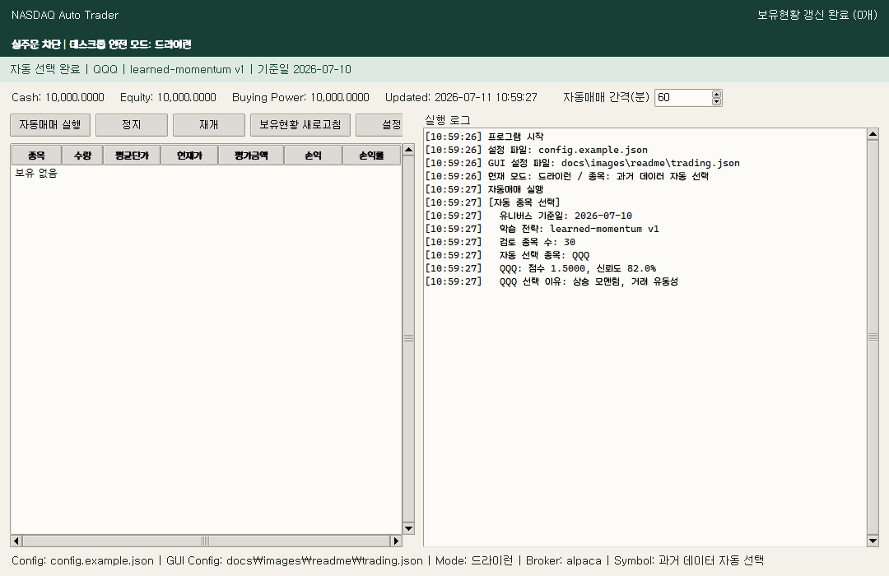
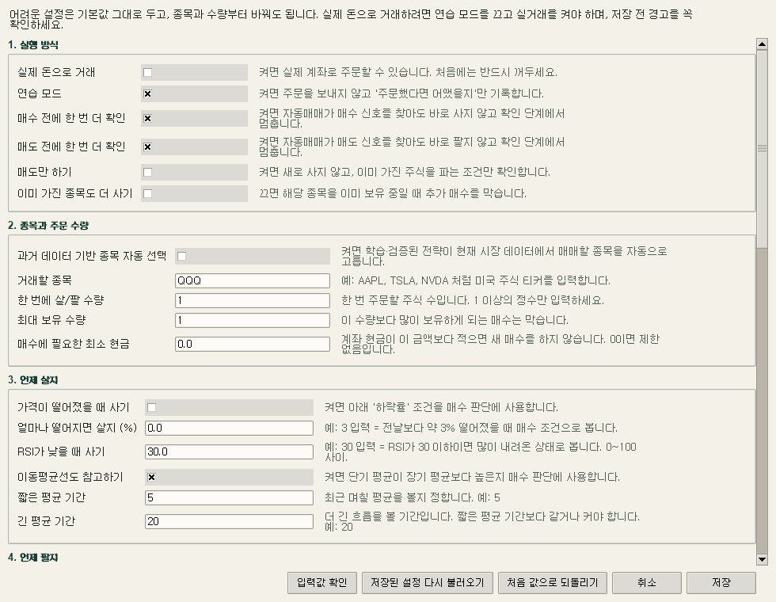
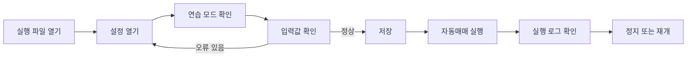
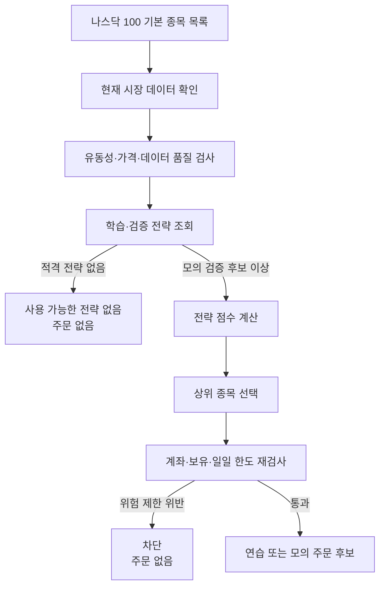
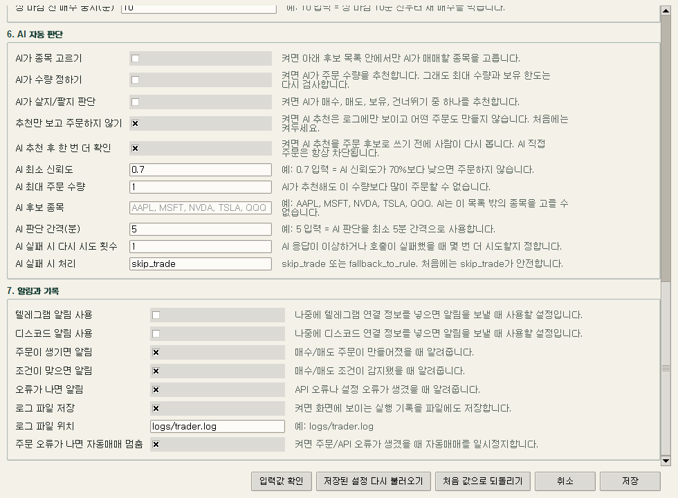
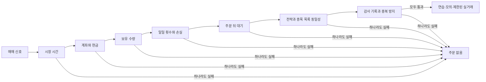

<!-- markdownlint-disable MD013 MD033 -->

# 나스닥 자동매매 도우미

> 학습·검증된 전략으로 나스닥 종목을 고르고, 여러 안전 장치를 거쳐 매매 후보를 만드는 윈도우용 프로그램

기본 상태: **연습 모드** · 데스크톱 실주문: **차단** · 전체 자동 시험: **358개 통과**

> **주의**
> 이 프로그램은 수익을 보장하지 않습니다. 처음에는 반드시 `실제 돈으로 거래`를 끄고 `연습 모드`를 켜세요.
> 연습 모드는 실제 주문을 보내지 않고 “주문했다면 어땠을지”만 계산하고 기록합니다.



## 30초 요약

| 궁금한 점 | 답 |
| --- | --- |
| 무엇을 하나요? | 가격과 거래량, 기술 지표, 학습·검증된 전략을 이용해 매매 후보를 찾고 위험 한도를 검사합니다. |
| 종목을 직접 골라야 하나요? | 아닙니다. 적격 학습 전략이 있으면 나스닥 100 종목 안에서 자동으로 고를 수 있습니다. |
| 설치 직후 바로 자동 선택되나요? | 아닙니다. 사용할 수 있는 모의 검증 후보 또는 대표 전략이 없으면 주문 없이 멈춥니다. |
| 실행 파일을 열면 실제 주문이 나가나요? | 아닙니다. 데스크톱 실행 파일의 실주문은 차단되어 있고 기본값도 연습 모드입니다. |
| 처음에 무엇을 해야 하나요? | 실행 → 설정 → 안전값 확인 → 입력값 확인 → 저장 → 필요하면 `학습만 실행` → 자동매매 실행 순서로 진행합니다. |
| 문제가 생기면 어디를 보나요? | 오른쪽 `실행 로그`와 [자주 발생하는 오류](#자주-발생하는-오류)를 확인합니다. |

## 바로 찾기

- [처음 사용하는 사람을 위한 5분 시작](#처음-사용하는-사람을-위한-5분-시작)
- [메인 화면 읽는 법](#메인-화면-읽는-법)
- [자동 종목 선택 원리](#자동-종목-선택은-어떻게-작동하나요)
- [모든 설정 설명](#설정-전체-설명)
- [자주 발생하는 오류](#자주-발생하는-오류)
- [증권사 연결](#증권사-연결)
- [명령줄 사용법](#명령줄-사용법)
- [실행 파일 빌드와 배포](#실행-파일-빌드와-배포)
- [안전 장치와 한계](#안전-장치와-한계)

## 처음 사용하는 사람을 위한 5분 시작

### 1. 폴더 전체를 확인합니다

`NasdaqAutoTrader.exe` 하나만 떼어내면 실행되지 않습니다. 아래 폴더를 통째로 사용하세요.

```text
dist\
└─ NasdaqAutoTrader\
   ├─ NasdaqAutoTrader.exe
   ├─ config.example.json
   ├─ config.kis.json
   ├─ .env.example
   └─ _internal\
```

`config.kis.json`은 빌드할 때 원본 파일이 있을 때만 포함됩니다. 개인 매매 설정인 `trading_config.json`은 실행 파일 폴더에 복사하지 않습니다. `_internal` 폴더는 반드시 실행 파일 옆에 있어야 합니다.

### 2. 프로그램을 실행합니다

`dist\NasdaqAutoTrader\NasdaqAutoTrader.exe`를 두 번 누릅니다.

소스 코드가 있는 개발 환경에서는 다음 명령으로 같은 화면을 열 수 있습니다.

```powershell
.\run_trader_gui.ps1
```

### 3. 안전 문구를 확인합니다

화면 위쪽에 다음 의미의 문구가 보여야 합니다.

```text
실주문 차단 | 데스크톱 안전 모드: 드라이런
```

이 문구가 없거나 실거래 경고가 보이면 `자동매매 실행`을 누르지 말고 설정부터 확인하세요.

### 4. 설정을 엽니다

메인 화면의 `설정` 버튼을 누릅니다. 처음에는 아래 값을 사용하세요.

| 설정 | 처음 권장값 | 이유 |
| --- | ---: | --- |
| 실제 돈으로 거래 | 꺼짐 | 실계좌 주문을 허용하지 않습니다. |
| 연습 모드 | 켜짐 | 주문 없이 동작을 확인합니다. |
| 매수 전에 한 번 더 확인 | 켜짐 | 매수 후보가 생겨도 바로 주문하지 않습니다. |
| 매도 전에 한 번 더 확인 | 켜짐 | 매도 후보가 생겨도 바로 주문하지 않습니다. |
| 한 번에 살/팔 수량 | 1 | 작은 수량으로 흐름을 확인합니다. |
| 최대 보유 수량 | 1 이상 | 한 번 주문 수량보다 작을 수 없습니다. |
| 하루 최대 매수 횟수 | 1 | 반복 매수 위험을 줄입니다. |
| 하루 최대 매도 횟수 | 1 | 반복 매도 위험을 줄입니다. |
| 주문 오류가 나면 자동매매 멈춤 | 켜짐 | 같은 오류가 반복되는 것을 막습니다. |
| 추천만 보고 주문하지 않기 | 켜짐 | 기존 인공지능 추천을 기록만 합니다. |



### 5. 종목 선택 방법을 정합니다

| 원하는 방법 | 설정 |
| --- | --- |
| 내가 종목을 정함 | `과거 데이터 기반 종목 자동 선택`을 끄고 `거래할 종목`에 QQQ, AAPL 같은 티커를 입력합니다. |
| 학습 결과가 종목을 정함 | `과거 데이터 기반 종목 자동 선택`을 켭니다. |

자동 선택을 켜면 `거래할 종목`과 기존 `AI 후보 종목` 입력란이 잠깁니다. 저장된 값은 지워지지 않습니다. 자동 선택을 끄면 다시 편집할 수 있습니다.

### 6. 입력값을 검사하고 저장합니다

설정창 아래에서 다음 순서로 누릅니다.

1. `입력값 확인`
2. 오류가 없으면 `저장`
3. 메인 화면 오른쪽 로그에서 `설정 저장 및 내부 설정 갱신 완료` 확인

### 7. 자동매매를 시작합니다

메인 화면에서 자동매매 간격을 분 단위로 정한 뒤 `자동매매 실행`을 누릅니다.



> **중요**
> `정지`는 다음 자동매매 주기를 멈춥니다. 이미 진행 중인 연결 요청은 끝난 뒤 멈춥니다.
> `재개`를 누르면 다음 예약 주기부터 다시 실행합니다.

## 메인 화면 읽는 법

| 화면 영역 | 무엇을 보여 주나요? | 무엇을 확인하나요? |
| --- | --- | --- |
| 맨 위 안전 배너 | 현재 모드와 실주문 차단 상태 | `드라이런` 또는 `실주문 차단`인지 확인 |
| 자동 선택 상태 줄 | 선택 종목, 전략 이름·버전, 데이터 기준일 | `선택 완료` 또는 차단 사유 확인 |
| 계좌 요약 | 현금, 평가금, 매수 가능 금액, 갱신 시간 | 값이 비정상적이면 시작하지 않기 |
| 보유 현황 | 종목, 수량, 평균단가, 현재가, 평가금액, 손익 | 보유 수량과 손익 확인 |
| 자동매매 간격 | 다음 판단까지 기다리는 시간 | 처음에는 60분 권장 |
| 실행 버튼 | 실행, 정지, 재개, 새로고침, 학습만 실행, 설정 | 필요한 작업만 한 번씩 누르기 |
| 실행 로그 | 선택 이유, 신호, 주문 없음, 차단, 오류 | 문제가 생기면 마지막 줄부터 읽기 |

## 자동 종목 선택은 어떻게 작동하나요?

`과거 데이터 기반 종목 자동 선택`은 단순히 많이 오른 종목을 고르는 기능이 아닙니다.



### 자동 선택 상태표

| 상태 문자열 | 뜻 | 해야 할 일 |
| --- | --- | --- |
| `selected` | 적격 전략과 데이터가 있어 종목을 골랐습니다. | 선택 이유와 점수를 로그에서 확인 |
| `no_trade` | 정상적으로 검사했지만 거래 조건이 아닙니다. | 기다리거나 다음 주기 확인 |
| `blocked` | 설정, 전략, 데이터 또는 위험 제한 때문에 중단했습니다. | 로그의 차단 사유 수정 |
| `eligible_strategy_unavailable` | 사용할 수 있는 학습 전략이 없습니다. | 수동 종목을 사용하거나 인공지능 퀀트 연구실에서 적격 전략 생성 |

새 배포본에는 개인의 학습 전략이 포함되지 않습니다. 처음 자동 선택을 켰을 때 `eligible_strategy_unavailable`가 나오는 것은 정상입니다. 이때 수동 티커로 몰래 대체하거나 주문하지 않습니다. 메인 화면의 `학습만 실행`은 브로커·시세 공급자에서 받은 **마지막 완료 일봉까지만** 수집해 검증합니다. 연결 키나 실제 시세가 없으면 가짜 가격을 만들지 않고 `market_data_missing`으로 멈춥니다. 검증을 통과한 후보는 모의 운용 후보로만 저장되며 실거래 권한은 생기지 않습니다.

### 자동 선택과 기존 인공지능 추천의 차이

| 구분 | 과거 데이터 기반 종목 자동 선택 | 인공지능 자동 판단 |
| --- | --- | --- |
| 후보 범위 | 기본 나스닥 100 종목 목록 | 사용자가 적은 후보 종목 |
| 판단 근거 | 등록된 학습·검증 전략과 시장 데이터 | 외부 또는 기존 인공지능 추천 자료 |
| 주문 경계 | 연습·모의거래에서 위험 검사 후 후보 생성 | 직접 주문은 `ai_direct_order_disabled`로 차단 |
| 처음 권장 | 적격 전략이 준비된 뒤 켜기 | `추천만 보고 주문하지 않기` 유지 |



## 실행 모드 비교

| 모드 문자열 | 실제 증권사 주문 | 연결 키 필요 | 초보자 권장 | 설명 |
| --- | ---: | ---: | ---: | --- |
| `dry_run` | 없음 | 시세 조회 방식에 따라 다름 | 권장 | 후보 주문만 계산하고 기록 |
| `paper` | 모의계좌 주문 | 필요 | 연습 확인 후 | 증권사의 모의투자 계좌에 주문 |
| `live` | 실계좌 주문 가능 | 필요 | 권장하지 않음 | 설정·명시적 확인·시간·횟수 제한을 모두 통과해야 함 |

데스크톱 화면은 실거래 설정을 감지하면 주문 전에 차단합니다. 자동 선택 실주문은 제한된 명령줄 경로에서만 허용됩니다.

## 설정 전체 설명

설정은 `trading_config.json`에 저장됩니다. 실행 파일은 새로 빌드해도 지워지지 않도록 `%LOCALAPPDATA%\NasdaqAutoTrader\trading_config.json`을 사용합니다. 이 파일은 배포 폴더에 복사하지 않으므로 새로 빌드해도 저장값이 사라지지 않습니다. 소스 실행은 현재 작업 폴더 또는 `--trading-config`로 지정한 파일을 사용합니다.

<details>
<summary><strong>1. 실행 방식</strong></summary>

| 화면 이름 | 뜻 | 기본값 |
| --- | --- | ---: |
| 실제 돈으로 거래 | 실계좌 주문 가능 여부입니다. 처음에는 반드시 끕니다. | 꺼짐 |
| 연습 모드 | 주문 없이 후보만 기록합니다. 켜져 있으면 실거래보다 우선합니다. | 켜짐 |
| 매수 전에 한 번 더 확인 | 매수 후보를 확인 단계에서 멈춥니다. | 켜짐 |
| 매도 전에 한 번 더 확인 | 매도 후보를 확인 단계에서 멈춥니다. | 켜짐 |
| 매도만 하기 | 새 매수 없이 보유 종목의 매도 조건만 봅니다. | 꺼짐 |
| 이미 가진 종목도 더 사기 | 꺼져 있으면 보유 종목 추가 매수를 막습니다. | 꺼짐 |

</details>

<details>
<summary><strong>2. 종목과 주문 수량</strong></summary>

| 화면 이름 | 뜻 | 입력 규칙 |
| --- | --- | --- |
| 과거 데이터 기반 종목 자동 선택 | 적격 학습 전략이 현재 데이터에서 종목을 선택합니다. | 켜기 또는 끄기 |
| 거래할 종목 | 수동 모드의 종목 티커입니다. | 영문·숫자·점·하이픈만 |
| 한 번에 살/팔 수량 | 한 번 주문할 주식 수입니다. | 1 이상의 정수 |
| 최대 보유 수량 | 이 수량을 넘기는 매수를 막습니다. | 한 번 주문 수량 이상 |
| 매수에 필요한 최소 현금 | 현금이 이 값보다 적으면 매수하지 않습니다. | 0 이상, 0은 제한 없음 |

</details>

<details>
<summary><strong>3. 언제 살지</strong></summary>

| 화면 이름 | 뜻 | 입력 규칙 |
| --- | --- | --- |
| 가격이 떨어졌을 때 사기 | 전일 대비 하락률을 매수 판단에 사용합니다. | 켜기 또는 끄기 |
| 얼마나 떨어지면 살지 (%) | 예: 3은 약 3% 하락입니다. | 0 이상 |
| 상대강도지수가 낮을 때 사기 | 낮은 상대강도지수를 과도한 하락 참고값으로 사용합니다. | 0부터 100 |
| 이동평균선도 참고하기 | 단기 평균이 장기 평균보다 높은지 봅니다. | 켜기 또는 끄기 |
| 짧은 평균 기간 | 단기 이동평균 일수입니다. | 1 이상의 정수 |
| 긴 평균 기간 | 장기 이동평균 일수입니다. | 짧은 기간 이상 |

</details>

<details>
<summary><strong>4. 언제 팔지</strong></summary>

| 화면 이름 | 뜻 | 입력 규칙 |
| --- | --- | --- |
| 수익이 나면 팔기 (%) | 매수가 대비 목표 수익률입니다. | 0 이상 |
| 손실이 커지면 팔기 (%) | 매수가 대비 손절 참고율입니다. | 0 이상 |
| 고점에서 밀리면 팔기 | 최근 고점 대비 하락을 매도 조건으로 봅니다. | 켜기 또는 끄기 |
| 고점 대비 하락률 (%) | 고점 추적 손절 하락률입니다. | 0 이상 |
| 상대강도지수가 높을 때 팔기 | 높은 상대강도지수를 과도한 상승 참고값으로 사용합니다. | 0부터 100 |
| 오래 들고 있으면 팔기 | 보유 시간을 매도 조건으로 사용합니다. | 켜기 또는 끄기 |
| 최대 보유 시간(분) | 시간 기준 매도 조건입니다. | 1 이상의 정수 |

</details>

<details>
<summary><strong>5. 위험 제한</strong></summary>

| 화면 이름 | 뜻 | 입력 규칙 |
| --- | --- | --- |
| 하루 최대 매수 횟수 | 미국 시장일 기준 매수 상한입니다. | 1 이상의 정수 |
| 하루 최대 매도 횟수 | 미국 시장일 기준 매도 상한입니다. | 1 이상의 정수 |
| 하루 최대 손실률 (%) | 도달하면 새 매수를 막고 차단 상태를 유지합니다. | 0 이상 |
| 주문 후 쉬는 시간 사용 | 주문 직후 추가 매수를 쉬게 합니다. | 켜기 또는 끄기 |
| 주문 후 쉬는 시간(분) | 주문 뒤 대기 시간입니다. | 0 이상의 정수 |
| 장 시작 직후 쉬기(분) | 미국장 개장 직후 새 매수를 막습니다. | 0 이상의 정수 |
| 장 마감 전 매수 중지(분) | 마감 직전 새 매수를 막습니다. | 0 이상의 정수 |

</details>

<details>
<summary><strong>6. 인공지능 자동 판단</strong></summary>

| 화면 이름 | 뜻 | 처음 권장 |
| --- | --- | --- |
| AI가 종목 고르기 | 후보 목록 안에서만 종목을 추천합니다. | 꺼짐 |
| AI가 수량 정하기 | 주문 수량을 추천하되 보유 한도를 다시 검사합니다. | 꺼짐 |
| AI가 살지/팔지 판단 | 매수, 매도, 보유, 건너뛰기 중 하나를 추천합니다. | 꺼짐 |
| 추천만 보고 주문하지 않기 | 추천을 로그에만 남깁니다. | 켜짐 |
| AI 추천 후 한 번 더 확인 | 사람이 다시 확인합니다. | 켜짐 |
| AI 최소 신뢰도 | 0부터 1 사이입니다. 0.7은 70%입니다. | 0.7 |
| AI 최대 주문 수량 | 추천 수량 상한입니다. 수량 추천을 켜면 최대 보유 수량 이하여야 합니다. | 1 |
| AI 후보 종목 | 쉼표로 구분한 종목 티커 목록입니다. | AAPL, MSFT, NVDA, TSLA, QQQ |
| AI 판단 간격(분) | 인공지능 판단 사이의 최소 시간입니다. | 5 |
| AI 실패 시 다시 시도 횟수 | 잘못된 응답 또는 호출 실패 재시도 수입니다. | 1 |
| AI 실패 시 처리 | `skip_trade` 또는 `fallback_to_rule`입니다. | `skip_trade` |

인공지능 추천 자료는 다음 구조로 검사됩니다.

```json
{
  "action": "buy",
  "ticker": "NVDA",
  "order_qty": 1,
  "confidence": 0.82,
  "reason": "단기 추세와 거래량이 양호함",
  "risk": "장중 변동성이 높음"
}
```

후보 밖 종목, 잘못된 자료 형식, 낮은 신뢰도, 과한 수량, 현금 부족, 보유 한도 초과, 매도 전용 모드, 일일 손실 한도, 마감 전 매수 제한에 걸리면 주문 후보를 만들지 않습니다.

</details>

<details>
<summary><strong>7. 알림과 기록</strong></summary>

| 화면 이름 | 뜻 | 기본값 |
| --- | --- | ---: |
| 텔레그램 알림 사용 | 향후 연결 정보를 넣기 위한 준비용 설정입니다. 현재 이 값만으로 메시지가 전송되지는 않습니다. | 꺼짐 |
| 디스코드 알림 사용 | 향후 연결 정보를 넣기 위한 준비용 설정입니다. 현재 이 값만으로 메시지가 전송되지는 않습니다. | 꺼짐 |
| 주문이 생기면 알림 | 주문 후보 또는 주문 사건 알림 조건입니다. | 켜짐 |
| 조건이 맞으면 알림 | 매매 신호 알림 조건입니다. | 켜짐 |
| 오류가 나면 알림 | 연결·설정 오류 알림 조건입니다. | 켜짐 |
| 로그 파일 저장 | 화면 로그를 파일에도 저장합니다. | 켜짐 |
| 로그 파일 위치 | 상대 경로면 프로그램 자료 폴더 아래에 저장합니다. | `logs/trader.log` |
| 주문 오류가 나면 자동매매 멈춤 | 주문 또는 연결 오류 뒤 다음 주기를 정지합니다. | 켜짐 |

</details>

## 설정값 검사 규칙

저장 전에 다음 규칙을 모두 확인합니다.

- 수동 종목 모드의 티커는 비어 있을 수 없습니다.
- 티커에는 영문, 숫자, 점, 하이픈만 사용할 수 있습니다.
- 주문 수량과 최대 보유 수량은 1 이상의 정수여야 합니다.
- 최대 보유 수량은 한 번 주문 수량보다 작을 수 없습니다.
- 금액, 하락률, 손절률, 익절률, 일일 손실률은 0 이상이어야 합니다.
- 상대강도지수 기준은 0부터 100 사이여야 합니다.
- 긴 이동평균 기간은 짧은 이동평균 기간보다 작을 수 없습니다.
- 로그 저장을 켜면 로그 파일 위치가 비어 있을 수 없습니다.
- 인공지능 최소 신뢰도는 0부터 1 사이여야 합니다.
- 인공지능 수량 추천을 켜면 인공지능 최대 주문 수량은 최대 보유 수량 이하여야 합니다.
- 인공지능 기능을 켜면 후보 종목이 하나 이상 있어야 합니다.
- 인공지능 실패 처리는 `skip_trade` 또는 `fallback_to_rule`만 허용합니다.

`실제 돈으로 거래`와 `연습 모드`를 함께 켜면 연습 모드가 우선합니다. 저장 경고가 나더라도 데스크톱 실주문은 차단됩니다.

## 파일과 저장 위치

| 파일 또는 폴더 | 역할 | 보안 주의 |
| --- | --- | --- |
| `config.example.json` | 전략, 위험 한도, 증권사 종류 등 기본 앱 설정 | 연결 키를 넣지 않는 예제 파일 |
| `config.kis.json` | 한국투자증권용 앱 설정 | 계좌번호와 키는 넣지 말고 `.env` 사용 |
| `%LOCALAPPDATA%\NasdaqAutoTrader\trading_config.json` | 실행 파일 화면에서 저장한 쉬운 설정 | 개인 매매 기준이 들어 있으므로 공유 주의. 빌드 산출물에는 포함하지 않음 |
| `trading_config.json` | 소스 실행 또는 명령줄에서 직접 지정할 수 있는 쉬운 설정 파일 | 개인 매매 기준이 들어 있으므로 공유 주의 |
| `.env` | 증권사 연결 키와 계좌번호 | 저장소, 메신저, 공개 폴더에 올리지 않기 |
| `%LOCALAPPDATA%\NasdaqAutoTrader` | 로그, 세션 상태, 자동 선택 캐시, 전략 운영 파일, 토큰 캐시 | 다른 사용자에게 공유하지 않기 |

상대 로그 경로인 `logs/trader.log`는 실제로 `%LOCALAPPDATA%\NasdaqAutoTrader\logs\trader.log`에 저장됩니다.

실행 파일은 다음 순서로 `.env`를 찾습니다.

1. `dist\NasdaqAutoTrader\.env`
2. `dist\.env`

윈도우 환경 변수에 같은 이름이 있으면 환경 변수 값이 우선합니다.

## 증권사 연결

> **경고**
> 연결 키를 문서, 화면 캡처, 저장소, 메신저에 적지 마세요. `.env`는 개인 컴퓨터에만 보관하세요.

### 한국투자증권

`.env.example`을 복사해 `.env`로 이름을 바꾸고 개인 컴퓨터에서만 값을 입력합니다.

```dotenv
KIS_APP_KEY=본인의_앱키
KIS_APP_SECRET=본인의_앱시크릿
KIS_ACCOUNT_NO=계좌번호_앞_8자리
KIS_ACCOUNT_PRODUCT_CODE=01
KIS_ORDER_EXCHANGE_CODE=NASD
KIS_PRICE_EXCHANGE_CODE=NAS
KIS_CURRENCY=USD
```

해외주식 주문은 정수 수량의 지정가 주문입니다. 매수 금액은 최신 가격을 기준으로 정수 주식 수로 바뀝니다.

### 알파카

```dotenv
ALPACA_API_KEY=본인의_연결키
ALPACA_SECRET_KEY=본인의_비밀키
ALPACA_DATA_FEED=iex
```

무료 요금제 실험은 보통 `iex` 시세를 사용합니다. 구독 권한이 있을 때만 `sip`를 사용하세요.

## 자주 발생하는 오류

| 화면 또는 로그 | 원인 | 해결 |
| --- | --- | --- |
| `AI 최대 주문 수량은 최대 보유 수량보다 작거나 같아야 합니다.` | `AI가 수량 정하기`가 켜졌고 인공지능 최대 수량이 더 큽니다. | 인공지능 최대 수량을 낮추거나 최대 보유 수량을 높입니다. |
| `eligible_strategy_unavailable` | 사용할 수 있는 모의 검증 후보 또는 대표 전략이 없습니다. | 실주문은 하지 말고, `학습만 실행`으로 연구·검증을 먼저 돌리거나 자동 선택을 끄고 연습 모드에서 수동 종목을 사용합니다. |
| `ticker must not be empty` | 수동 종목 모드인데 티커가 비어 있습니다. | `거래할 종목`에 QQQ 같은 티커를 입력합니다. |
| `max_position_qty must be greater than or equal to order_qty` | 최대 보유 수량이 한 번 주문 수량보다 작습니다. | 최대 보유 수량을 주문 수량 이상으로 바꿉니다. |
| `long_ma_period must be greater than or equal to short_ma_period` | 긴 평균 기간이 짧은 평균 기간보다 작습니다. | 긴 평균 기간을 같거나 크게 바꿉니다. |
| `settings JSON parse failed` | `trading_config.json`의 쉼표나 따옴표가 깨졌습니다. | 파일을 백업한 뒤 문법을 고치거나 정상 예제 파일로 복구합니다. |
| `paper/live mode requires...` | 모의 또는 실거래 모드인데 연결 키가 없습니다. | `.env` 위치와 키 이름을 확인합니다. |
| `outside_regular_market_hours` | 미국 정규장 시간이 아닙니다. | 정규장에 다시 실행합니다. 연습 모드는 후보 계산을 계속할 수 있습니다. |
| `session_store_corrupt` | 재시작 안전 상태 파일이 손상되었습니다. | 자동매매를 멈추고 상태 파일과 로그를 보존한 뒤 원인을 확인합니다. |
| 실행 파일이 열리지 않음 | 실행 파일만 복사했거나 `_internal`이 없습니다. | `NasdaqAutoTrader` 폴더 전체를 다시 복사합니다. |
| 자동매매 실행 후 주문 없음 | 연습 모드, 확인 대기, 거래 조건 없음 또는 위험 차단입니다. | 실행 로그의 마지막 차단 사유를 확인합니다. |

문제가 해결되지 않으면 다음 정보를 확인합니다. 연결 키와 계좌번호는 절대 포함하지 마세요.

```text
1. 화면 위쪽의 현재 모드
2. 실행 로그 마지막 20줄
3. 사용한 설정 파일 경로
4. 비밀값을 뺀 trading_config.json
5. 문제가 발생한 시간과 누른 버튼
```

## 명령줄 사용법

### 설치와 기본 검사

먼저 공식 NASDAQ 거래일 캘린더 의존성을 설치합니다.

```powershell
python -m pip install -r requirements-runtime.txt
```

파이썬 3.11 이상을 사용합니다. 핵심 실행에는 별도 패키지가 필요하지 않습니다. 실행 파일 빌드에는 `PyInstaller`가 필요합니다.

```powershell
python -m unittest discover -s tests -v
python -m nasdaq_auto_trader --config config.example.json show-config
```

### 자주 쓰는 명령

| 목적 | 명령 |
| --- | --- |
| 화면 실행 | `python -m nasdaq_auto_trader --config config.kis.json gui` |
| 자동 종목 선택만 미리보기 | `python -m nasdaq_auto_trader --config config.example.json select-symbols --trading-config trading_config.json` |
| 연습 1회 | `python -m nasdaq_auto_trader --config config.example.json once --mode dry_run` |
| 자동 선택 연습 1회 | `python -m nasdaq_auto_trader --config config.example.json once --mode dry_run --auto-select --trading-config trading_config.json` |
| 60분 간격 자동 선택 반복 | `python -m nasdaq_auto_trader --config config.example.json loop --mode dry_run --auto-select --trading-config trading_config.json --interval-minutes 60` |
| 반복 기능을 한 번만 시험 | `python -m nasdaq_auto_trader --config config.example.json loop --mode dry_run --interval-minutes 1 --max-runs 1` |
| 한국투자증권 매수 가능 금액 확인 | `python -m nasdaq_auto_trader --config config.kis.json buying-power --symbol QQQ --qty 1` |
| 외부 다중 분석 도구의 무주문 분석 | `python -m nasdaq_auto_trader --config config.example.json trading-agents --symbol NVDA --date 2026-01-15` |

모든 선택 항목은 다음처럼 확인합니다.

```powershell
python -m nasdaq_auto_trader --help
python -m nasdaq_auto_trader once --help
python -m nasdaq_auto_trader loop --help
python -m nasdaq_auto_trader ai-quant --help
```

### 과거 자료 시험

입력 파일은 다음 열 이름을 포함해야 합니다.

```csv
symbol,timestamp,open,high,low,close,volume
QQQ,2026-01-01T09:30:00-05:00,100,101,99,100,1000000
```

```powershell
python -m nasdaq_auto_trader --config config.example.json backtest --csv path\to\bars.csv --cash 10000
```

신호는 종가까지 알려진 자료로 만들고 다음 봉 시가에 체결된 것으로 계산합니다. 결과에는 수익률, 최대 낙폭, 샤프 비율, 거래 횟수, 승률, 거래 내역이 포함됩니다.

부분 체결, 실제 미끄러짐, 공매도 차입, 수수료, 세금, 거래 정지는 계산하지 않습니다.

### 당일 1주 시험 계획

`day-test`는 보수적인 후보 중 1주 매수·매도 계획을 만듭니다. `--dry-run`을 사용하면 주문하지 않습니다. `--live-trading`은 정확한 최종 확인 뒤 실주문으로 이어질 수 있으므로 초보자는 사용하지 마세요.

```powershell
python -m nasdaq_auto_trader --config config.kis.json day-test --candidate QQQ --max-total-usd 100 --dry-run
```

### 기존 HIVE 1주 매도 감시

`sell-monitor`는 기존 HIVE 1주 보유분만 감시하도록 제한된 전용 명령입니다. 기본은 수익 실현 또는 보유이며, 손절·고점 추적 손절·마감 전 강제 매도는 각각 선택해야 켜집니다.

```powershell
python -m nasdaq_auto_trader --config config.kis.json sell-monitor --dry-run --max-loops 1
```

### 인공지능 퀀트 연구실

이 기능은 전략 연구, 검증, 가상 체결, 대표 전략 잠금, 성능 저하 감시, 거래 없음 상태로 되돌리기를 다루는 별도 안전 운영 경로입니다.

#### 전략은 어떻게 만들어지고 검증되나요?

```text
[출처가 있는 연구]
         ↓
[전략 후보 작성]
         ↓
[과거 가격으로 다음 날 시가 체결 시험]
         ↓
[거래비용·낙폭·회전율·과적합 검사]
         ↓
    ┌────┴────┐
 [탈락]    [점수 검사]
               ↓
       ┌───────┴───────┐
    [탈락]         [모의 후보]
                         ↓
              [현재 버전은 여기서 멈춤]
```

프로그램은 다음 순서로 움직입니다.

1. 허용된 13개 전략 계열, 시계열 분할 검증, 시장 국면 판별에 관한 조사 결과를 모읍니다.
2. 출처 주소와 조사 식별자가 모두 있는 자료만 전략 후보 작성에 사용합니다.
3. 후보가 정해진 전략 형식, 손절 규칙, 보유 기간, 종목당 최대 비중, 긴급 중지 규칙을 빠짐없이 갖췄는지 검사합니다.
4. 과거 가격에서 오늘 종가까지의 정보로 신호를 만들고 다음 거래일 시가에 체결된 것으로 계산합니다.
5. 매수와 매도를 한 쌍으로 묶어 승률, 손익비, 기대값, 회전율을 계산합니다. 수수료와 미끄러짐도 매수·매도 가격에 각각 반영합니다.
6. 시계열 안정성 간이 검사와 최종 점수 검사를 모두 통과한 후보만 `모의 후보`로 등록합니다.
7. 통과해도 실주문 권한은 생기지 않습니다. 현재 버전에는 모의 후보를 대표 전략이나 실거래 전략으로 올리는 완성된 운영 절차가 없으므로, 모의 후보 상태에서만 관찰해야 합니다.

| 검사 항목 | 통과 기준 | 뜻 |
| --- | ---: | --- |
| 자산 곡선 길이 | 60개 이상 | 너무 짧은 자료로 내린 결론을 차단합니다. |
| 최대 낙폭 | 20% 이하 | 고점에서 크게 무너지는 전략을 차단합니다. |
| 회전율 | 0.50 이하 | 지나치게 자주 사고팔아 비용이 커지는 전략을 차단합니다. |
| 시간 분할 안정성 대리 점수 | 0.50 이상 | 자산 곡선을 다섯 구간으로 나눠 방향 안정성을 간단히 확인합니다. |
| 구간 조합 안정성 대리 점수 | 0.50 이상 | 구간 두 개씩 묶었을 때 양수인 조합의 비율을 확인합니다. |
| 과적합 위험 대리값 | 0.35 이하 | 음수 구간과 수익 방향 전환이 많은 후보를 차단합니다. |
| 보정 샤프 대리값 | 0.05 이상 | 자료 길이와 시험 횟수를 보수적으로 반영합니다. |
| 최종 점수 | 0.65 초과 | 수익, 손익비, 낙폭, 회전율, 자료 품질 벌점을 합친 마지막 문턱입니다. |

> **중요**
> 위 네 가지 과적합 관련 값은 실제 재학습을 반복하는 완전한 누수 제거 교차검증이나 조합 교차검증이 아니라 빠른 1차 선별용 대리값입니다. 실거래 가능성을 증명하지 않으며, 장기간 독립 자료 검증을 대신할 수 없습니다.

직접 실행할 때는 설정, 후보 전략, 과거 가격, 승인된 조사 명령이 모두 필요합니다. 아래의 꺾쇠 부분은 실제 파일과 명령으로 바꾸세요. 조사 명령은 마지막에 적어야 합니다.

```powershell
python -m nasdaq_auto_trader ai-quant --ai-config <인공지능_퀀트_설정.json> nightly --candidate-json <후보_전략.json> --bars-json <과거_가격.json> --insane-search-command <승인된_조사_명령>
```

결과의 `accepted_candidates`가 `0`이면 탈락입니다. `reasons`에 나온 원인을 먼저 해결해야 하며, 전략 기록 파일을 직접 고쳐 통과 상태로 만들면 안 됩니다. `accepted_candidates`가 `1`이어도 모의 후보일 뿐이며 실거래 전략이 아닙니다.

`champion-lock`과 `live-cycle`은 안전 차단 동작을 점검하기 위한 관리 명령입니다. 현재 버전에서는 모의 후보를 실거래 전략으로 자동 전환하지 않으며, 사용자가 기록 파일을 직접 고쳐 전환해서도 안 됩니다.

```powershell
python -m nasdaq_auto_trader ai-quant status
python -m nasdaq_auto_trader ai-quant gui
python -m nasdaq_auto_trader ai-quant nightly
python -m nasdaq_auto_trader ai-quant champion-lock --strategy-id strategy-1 --strategy-version v1
python -m nasdaq_auto_trader ai-quant paper-shadow --strategy-id strategy-1 --strategy-version v1 --symbol QQQ --side buy --price 100
python -m nasdaq_auto_trader ai-quant monitor-degradation --ledger-path data\ai_quant_lab\paper_shadow.jsonl
python -m nasdaq_auto_trader ai-quant rollback --reason strategy_drawdown_limit_exceeded
python -m nasdaq_auto_trader ai-quant live-cycle
```

기본 `status`는 `live_trading_disabled`를 보고합니다. `paper-shadow`는 가상 체결만 만듭니다. `nightly`는 승인된 조사 명령과 자료가 없으면 멈춥니다. 잘못되거나 부족한 전략, 관측 자료, 설정은 진행하는 대신 차단합니다.

야간 연구는 허용된 13개 전략 계열에 대해 출처가 있는 조사 자료를 요구합니다. 출처 없음, 중복, 모호함, 계열 누락이 있으면 후보 생성을 거부합니다. 생성된 전략도 감사된 조사 자료의 식별자를 인용해야 저장과 승격 평가로 넘어갑니다.

데스크톱 연구실 화면에는 실주문 실행 버튼이 없습니다. 전략 상태를 바꾸는 작업은 확인창을 거쳐야 합니다.

### 외부 다중 분석 도구

이 기능은 선택 설치이며 기본 의존성에 포함되지 않습니다.

```powershell
python -m pip install -r requirements-tradingagents.txt
python -m nasdaq_auto_trader --config config.example.json trading-agents --symbol NVDA
```

별도의 언어 모형 공급자 연결 키가 필요합니다. 명시적인 `trading-agents` 명령은 항상 `submitted_order=false`입니다. 외부 패키지가 없으면 프로그램 전체가 멈추는 대신 설치 명령이 포함된 `unavailable` 결과를 냅니다.

`config.example.json`의 `trading_agents` 묶음에서 다음 정책을 정합니다.

| 정책 문자열 | 동작 |
| --- | --- |
| `advisory` | 분석을 보여 주지만 주문 판단을 바꾸지 않습니다. |
| `confirm` | 기존 기술 신호와 동의할 때만 통과합니다. 사용할 수 없으면 기본 `fail_closed=true`에 따라 보유로 바뀝니다. |
| `replace` | 기술 행동을 분석 행동으로 바꾸지만 기존 위험·시장시간 검사를 다시 통과해야 합니다. |

### 제한된 실거래 명령

> **주의**
> 이 기능은 실제 계좌 주문으로 이어질 수 있습니다. 모의투자, 작은 금액 검증, 감시, 긴급 중지 절차를 먼저 완료해야 합니다.

설정 파일에서 다음 값이 모두 필요합니다.

```json
{
  "mode": "live",
  "allow_live_trading": true,
  "regular_market_hours_only": true
}
```

자동 선택 반복 실거래는 `--confirm-live-orders`, `--live-auth-minutes`, `--live-max-cycles`도 모두 필요합니다.

```powershell
python -m nasdaq_auto_trader --config private-live.json loop --mode live --auto-select --trading-config trading_config.json --confirm-live-orders --live-auth-minutes 15 --live-max-cycles 2
```

정규장 제한은 뉴욕 시간 기준입니다. 일반 거래일 09:30부터 16:00까지만 허용합니다. 주말, 주요 미국 주식시장 휴일, 13:00 조기 마감을 반영합니다.

## 기본 설정 파일 설명

`config.example.json`은 다음 묶음으로 나뉩니다.

| 묶음 | 역할 |
| --- | --- |
| `mode` | 연습, 모의, 실거래 모드 |
| `broker` | `alpaca` 또는 `kis` |
| `symbols` | 수동 기본 종목 목록 |
| `timeframe`, `lookback_days`, `bar_limit` | 시세 간격과 과거 자료 범위 |
| `allow_live_trading` | 실거래의 첫 번째 잠금 |
| `NASDAQ_AUTO_TRADER_ALLOW_LIVE` | 실거래의 두 번째 환경 잠금. 비공개 `.env`에서 정확히 `YES`일 때만 허용 |
| `regular_market_hours_only` | 미국 정규장 밖 주문 차단 |
| `alpaca`, `kis` | 증권사별 모의 여부, 시세, 거래소, 통화, 제한 시간 |
| `strategy` | 이동평균, 상대강도지수, 이동평균수렴확산, 변동성, 돌파, 점수, 손절·익절 기준 |
| `risk` | 최대 종목 비중, 현금 여유분, 최소·최대 주문 금액, 거래당 위험 |
| `trading_agents` | 선택형 외부 다중 분석 설정과 안전 정책 |

설정의 실제 전체 기본값은 [config.example.json](config.example.json)에서 확인할 수 있습니다.

## 전략과 위험 관리

### 계산하는 지표

단순 이동평균, 지수 이동평균, 상대강도지수, 이동평균수렴확산, 볼린저 밴드, 평균진폭, 돈치안 채널, 스토캐스틱, 가격 변화율, 거래량 평균을 계산합니다.

### 결합하는 판단

| 판단 요소 | 쉬운 설명 |
| --- | --- |
| 시장 국면 | 가격이 장기 평균 위인지 확인 |
| 추세 | 단기 평균이 장기 평균보다 강한지 확인 |
| 상승 힘 | 가격 변화율과 이동평균수렴확산 흐름 확인 |
| 돌파 | 이전 가격 범위 위로 올라섰는지 확인 |
| 평균 회귀 | 가격이 지나치게 내려왔는지 확인 |
| 거래량 | 최근 거래량이 평소보다 충분한지 확인 |
| 청산 | 고정 손절·익절, 평균진폭, 추세 붕괴, 과열, 돈치안 이탈 확인 |

예제 점수 기준은 보수적인 시작값이며 최적화된 수익 보장값이 아닙니다.

### 주문 전 안전 검사



## 실행 파일 빌드와 배포

### 빌드

```powershell
powershell -ExecutionPolicy Bypass -File .\scripts\build_gui_exe.ps1
```

결과 파일:

```text
dist\NasdaqAutoTrader\NasdaqAutoTrader.exe
```

빌드 스크립트는 다음 작업을 합니다.

1. 폴더형 실행 파일 빌드
2. 나스닥 100 기본 종목 자료 포함 여부 확인
3. 브로커 설정과 예제 설정만 복사
4. `.env`, 기존 토큰, 기존 로그, 배포 폴더의 개인 매매 설정 제거
5. 배포 폴더의 개인 자료와 실행 중 생성 파일 검사

`-IncludeEnv`는 보안상 의도적으로 차단되어 있습니다. 실제 키는 배포 후 개인 컴퓨터에서 `.env`에 넣습니다.

### 배포 확인표

- [ ] `NasdaqAutoTrader` 폴더 전체를 복사했다.
- [ ] `_internal` 폴더가 실행 파일 옆에 있다.
- [ ] `.env`를 메신저나 저장소에 올리지 않았다.
- [ ] 처음 실행은 `dry_run`이다.
- [ ] `실제 돈으로 거래`가 꺼져 있다.
- [ ] `입력값 확인`을 통과했다.
- [ ] 자동 선택을 쓸 경우 적격 전략 존재 여부를 확인했다.
- [ ] 실행 로그와 중지 방법을 확인했다.

하나의 자기 풀림 실행 파일 방식은 윈도우 보안 프로그램의 오탐을 일으켜 배포하지 않습니다. 공식 산출물은 폴더형 방식입니다.

## 안전 장치와 한계

### 안전 장치

- 기본 `dry_run`과 `allow_live_trading=false`
- 데스크톱 실주문 차단
- 미국 정규장, 휴일, 조기 마감 검사
- 최대 보유 수량, 현금 여유분, 주문 금액, 거래당 위험 제한
- 일일 주문 횟수, 일일 손실률, 주문 뒤 대기의 재시작 안전 상태
- 전략 식별자, 버전, 요약값과 종목 목록, 위험 설정의 주문 직전 재검사
- 같은 신호의 중복 주문 방지와 중단된 처리 복구
- 선택, 주문 의도, 주문 결과 감사 기록
- 손상되거나 불완전한 설정, 전략, 시장 자료의 안전 차단

### 보장하거나 계산하지 않는 것

- 수익 또는 원금
- 미래 시장 급변, 거래 정지, 호가 공백
- 과거 자료 시험의 부분 체결, 실제 미끄러짐, 세금, 모든 수수료
- 모든 증권사 장애와 연결 규격 변경
- 인공지능 추천의 정확성
- 사용자의 계좌 권한, 시세 구독, 환전 상태

> **경고**
> 과거 자료 시험 결과가 좋아도 실제 결과는 다를 수 있습니다. 별도 검증 자료, 거래비용 분석, 모의투자, 작은 규모의 단계적 검증, 실시간 감시를 거치세요.

## 개발 검증

현재 배포 기준:

- 전체 자동 시험 358개 통과
- 파이썬 문법 묶음 검사 통과
- 변경 파일 엄격 검사 통과
- 폴더형 실행 파일 빌드 통과
- 배포 폴더 개인 자료 검사 통과

```powershell
python -m unittest discover
python -m compileall nasdaq_auto_trader tests
python -m nasdaq_auto_trader.package_audit .\dist\NasdaqAutoTrader
```

## 용어 사전

| 용어 | 쉬운 뜻 |
| --- | --- |
| 티커 | 주식의 짧은 이름입니다. 예: 애플은 AAPL |
| 드라이런 | 실제 주문 없이 계산과 기록만 하는 연습 |
| 모의투자 | 증권사가 제공하는 가상 계좌 주문 |
| 실거래 | 실제 계좌와 실제 돈을 사용하는 모드 |
| 포지션 | 현재 보유한 종목과 수량 |
| 종목 목록 | 프로그램이 후보로 살펴보는 종목 모음 |
| 상대강도지수 | 가격이 최근 많이 올랐는지 내렸는지 보는 보조 지표 |
| 이동평균 | 일정 기간 가격의 평균 |
| 손절 | 손실이 더 커지기 전에 파는 기준 |
| 익절 | 목표 수익에 도달했을 때 파는 기준 |
| 최대 낙폭 | 자산이 이전 고점에서 얼마나 줄었는지 나타내는 값 |
| 안전 차단 | 정보가 없거나 이상하면 진행하지 않고 막는 방식 |
| 모의 검증 후보 | 가상 거래 검증 단계에 들어갈 자격을 얻은 전략 |
| 대표 전략 | 검증 결과 현재 대표로 잠긴 전략 |

## 책임 안내

이 저장소는 연구, 과거 자료 시험, 모의투자, 제한된 운영 검증을 위한 도구입니다. 투자 판단과 손실 책임은 사용자에게 있습니다. 실제 돈을 사용하기 전에 증권사 약관, 국가별 법규, 세금, 시세 구독 권한, 계좌 주문 권한을 직접 확인하세요.
